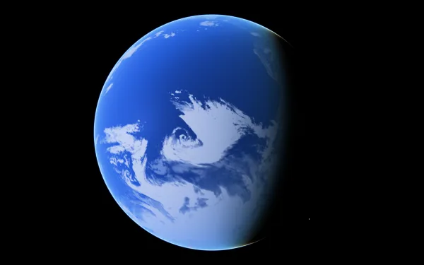
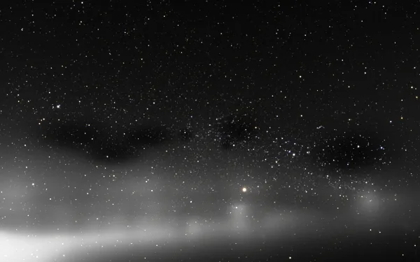
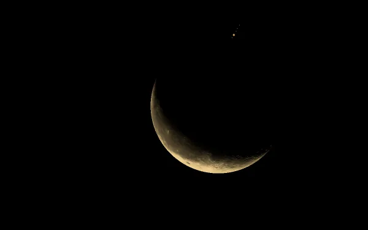

# Changelog

What's new in celestiary, newest first, by month. Each entry says what you can now see or do, and
links the pull requests and issues behind it, the epic it belongs to and, where there is one, a link
that opens the view.

This is the user-facing record. [ROADMAP.md](ROADMAP.md)'s *Done recently* stays the planning record.
A PR that changes what users see adds its entry here, in the same PR, as it does for the roadmap.
Housekeeping, refactors, CI and documentation fold into one "Behind the scenes" line a month.
Entries before 13 October 2026 were drafted from the merged pull requests by `tools/changelog/` and
edited by hand; the epic of an older entry is the one its topic belongs to in the roadmap.

`public/data/changelog.json`, which the app reads, is built from this file: run `yarn changelog` after
editing it. The format is in [tools/changelog/README.md](tools/changelog/README.md); an entry is:

```markdown
### A one-line headline: what you can now see or do

A sentence or two, plain and concrete.

- Date: 2026-10-13
- PR: [#242](https://github.com/celestiary/web/pull/242)
- Issue: [#241](https://github.com/celestiary/web/issues/241)
- Epic: [#118](https://github.com/celestiary/web/issues/118) Navigation, time and sharing
- Permalink: [Open this view](https://celestiary.org/#sun/earth@...) or none
- Image: 
```

`Issue`, `Epic` and `Image` are left out when there are none. `Permalink: none` marks an entry that
has no view to open yet.

## October 2026

### Earth loads faster: each picture is downloaded once

Opening Earth, or a link to it, used to download the month's 4096-pixel Blue Marble map three times,
once each for the surface, the clouds and the close-up layer, and the 1.4 MB backup cloud picture came
with every view though the day's satellite clouds replace it. Now the map is downloaded once and
shared, and the backup picture is fetched only where the satellites saw nothing, mostly the polar
night, and then as a 128 KB copy. Earth looks the same.

- Date: 2026-10-14
- PR: [#265](https://github.com/celestiary/web/pull/265)
- Issue: [#260](https://github.com/celestiary/web/issues/260)
- Epic: [#256](https://github.com/celestiary/web/issues/256) Leaner first load
- Permalink: [Open this view](https://celestiary.org/#sun/earth@-38.1501,-99.3434,12.104919Mm;t=9781.4376jd;cq=0.1302,-0.0725,0.0095,0.9888;fov=45deg;s=alpoF)

### The first screen loads faster: the planets' tables come after it

Celestiary now loads about 2.6 MB less before the first screen: the tables that place the planets were
most of the app's code, and they now load right after the scene appears. The code on the first load is
668 KB compressed instead of 2 MB. For the second or two until they are in, the planets are drawn from
approximate orbits, within a quarter of a degree of where they should be, and then glide to their exact
places over a second and a half, so nothing jumps.

- Date: 2026-10-14
- PR: [#263](https://github.com/celestiary/web/pull/263)
- Issue: [#257](https://github.com/celestiary/web/issues/257)
- Epic: [#256](https://github.com/celestiary/web/issues/256) Leaner first load
- Permalink: none

### Celestiary has its own address: celestiary.org

Celestiary now lives at celestiary.org. Links to the old celestiary.github.io address, including
links to a scene, keep working: they go to the same place at the new one.

- Date: 2026-10-14
- PR: [#254](https://github.com/celestiary/web/pull/254)
- Epic: [#244](https://github.com/celestiary/web/issues/244) What's new: a changelog, in the app, and as posts
- Permalink: none

### Earth's clouds without a seam at the date line

Earth's daily clouds no longer show a hard vertical edge across the Pacific at 180°. The day's cloud
map was cut there between satellite passes a day apart, so the clouds on each side didn't match. The
20° east of the date line now blend into the clouds from the day before, which were seen at the same
time as the other side of the cut. The map still appears as soon as the day has loaded, and the blend
follows a moment later.

- Date: 2026-10-14
- PR: [#252](https://github.com/celestiary/web/pull/252)
- Issue: [#251](https://github.com/celestiary/web/issues/251)
- Epic: [#110](https://github.com/celestiary/web/issues/110) Earth appearance parity across the Cesium swap
- Permalink: [Open this view](https://celestiary.org/#sun/earth@-10,180,15.310824Mm;t=9779.5417jd;cq=-0.0283,-0.4559,-0.0145,0.8895;fov=45deg;s=F)

### What's new on the homepage, and a tour of it

The homepage has a What's new button that opens the latest changes, each with its date and a few
words on what you can now see or do. An entry with a view flies there as the homepage's cards do, and
a small count on the button shows what has come since your last visit. A tour plays the entries that
have a view one after another, a caption under each: start it from the panel, or open
`#;news:tour` at the site's address. Space pauses it, the arrow keys skip, Esc stops it, and it
cuts between views instead of flying when your device asks for less motion.

- Date: 2026-10-14
- PR: [#253](https://github.com/celestiary/web/pull/253)
- Issue: [#246](https://github.com/celestiary/web/issues/246)
- Epic: [#244](https://github.com/celestiary/web/issues/244) What's new: a changelog, in the app, and as posts
- Permalink: none

### The homepage tour flies into Earth's shadow to see the city lights

The homepage's tour now passes over the evening's edge of daylight into Earth's shadow, where the
Sun is hidden behind Earth and the air glows as a thin ring round it. It waits there while your eyes
adjust, and the city lights come up. It picks whichever lit-up region is near midnight when you
visit: Europe, India, East Asia or the Americas, or the nearest lit coast when midnight is over the
Pacific. While the page loads, a little Moon now turns through its phases under the title.

- Date: 2026-10-13
- PR: [#249](https://github.com/celestiary/web/pull/249)
- Issue: [#241](https://github.com/celestiary/web/issues/241)
- Epic: [#118](https://github.com/celestiary/web/issues/118) Navigation, time and sharing
- Permalink: none

### Earth's clouds without a seam down the Atlantic

Earth's daily clouds no longer show a hard edge along 36° W. Each day's cloud map now appears all at
once when it has loaded, and a day the satellites haven't finished covering waits for the latest
complete one, so neighbouring pieces of the map always come from the same day.

- Date: 2026-10-13
- PR: [#250](https://github.com/celestiary/web/pull/250)
- Issue: [#243](https://github.com/celestiary/web/issues/243)
- Epic: [#110](https://github.com/celestiary/web/issues/110) Earth appearance parity across the Cesium swap
- Permalink: none

### A homepage at celestiary's address

Open celestiary with nothing after the address and you get a homepage: the title, a search box and
four scene cards over a slow tour of the live scene. The cards are tonight's sky from where you are,
Earth at dusk, the Moon hiding Jupiter and Gaia's stars, and each flies to its view. Esc or a click
on the scene leaves the homepage, and Back returns to it.

- Date: 2026-10-13
- PR: [#242](https://github.com/celestiary/web/pull/242)
- Issue: [#241](https://github.com/celestiary/web/issues/241)
- Epic: [#118](https://github.com/celestiary/web/issues/118) Navigation, time and sharing
- Permalink: none
- Image: 

### A calmer first load, and overlays that fade

The page opens in your light or dark theme and dims to black, then brings in the title, the scene,
and the orbits, labels and controls one after another. Orbits, labels, grids and the controls now
fade in and out when you toggle them. A link that hides the controls loads with no text at all.

- Date: 2026-10-11
- PR: [#239](https://github.com/celestiary/web/pull/239), [#240](https://github.com/celestiary/web/pull/240)
- Issue: [#238](https://github.com/celestiary/web/issues/238)
- Epic: [#118](https://github.com/celestiary/web/issues/118) Navigation, time and sharing
- Permalink: none

### Stars drawn as the eye sees a point of light

A bright star now has a white core and a halo that grow with its light, by the published function
for how the eye scatters light. Sirius is about 9 px wide on a 1080 px screen, and a star ten times
brighter is about twice as wide. Raising the star limit with `]` no longer turns every bright star
into the same disc, and the Sun's glare is now drawn from any distance.

- Date: 2026-10-11
- PR: [#237](https://github.com/celestiary/web/pull/237)
- Issue: [#235](https://github.com/celestiary/web/issues/235)
- Epic: [#109](https://github.com/celestiary/web/issues/109) Physically based light and exposure
- Permalink: none

### The Sun has sunspots, a corona and eclipses

The Sun now follows the date: sunspots from the observed record (1997 to today, then the forecast),
prominences and flares, a corona that changes with the cycle, and the solar wind. When the Moon
covers it you get a total eclipse. The link is Dallas at mid-totality on 8 April 2024.

- Date: 2026-10-11
- PR: [#227](https://github.com/celestiary/web/pull/227)
- Issue: [#167](https://github.com/celestiary/web/issues/167), [#168](https://github.com/celestiary/web/issues/168)
- Epic: [#164](https://github.com/celestiary/web/issues/164) Stars up close: a dynamic Sun, and every star from its physical parameters
- Permalink: [Open this view](https://celestiary.org/#sun/earth@32.78,-96.8009,200m;t=8864.2801jd;cq=0,-0.5777,0,0.8162;fov=3deg;s=lpoxF;time:pause)

### Clouds you can fly into

From about 30 km down, Earth's flat cloud layer gives way to ray-marched clouds with depth, seeded
from the day's NASA satellite picture and tallest where the clouds are thickest. The link looks
straight down from 12 km over the Gulf of Mexico on 28 August 2005, the day before Hurricane
Katrina's landfall.

- Date: 2026-10-11
- PR: [#225](https://github.com/celestiary/web/pull/225)
- Issue: [#169](https://github.com/celestiary/web/issues/169)
- Epic: [#111](https://github.com/celestiary/web/issues/111) Distinctive appearances: Sun, gas giants, rings, auroras
- Permalink: [Open this view](https://celestiary.org/#sun/earth@25,-88,12km;t=2066.4167jd;cq=-0.3707,-0.4287,-0.0058,0.8239;fov=45deg;s=alpoU)

### A million of Gaia's stars

Gaia's brightest stars, down to magnitude 10.8, are in: 925,686 added to the bundled Hipparcos
catalogue. They load in tiles as you look, brightest first, and move with the date. About a hundred
naked-eye stars the old catalogue left out now show too.

- Date: 2026-10-11
- PR: [#224](https://github.com/celestiary/web/pull/224)
- Issue: [#98](https://github.com/celestiary/web/issues/98)
- Epic: [#116](https://github.com/celestiary/web/issues/116) Milky Way: realistic structure, a million Gaia stars, and galactic dynamics
- Permalink: [Open this view](https://celestiary.org/#sun/earth@43.3389,-9.9593,30373373.021376Tm;t=9779.5692jd;cq=-0.436,0.7975,0.0666,0.4116;fov=45deg;ev=1.33;s=alovTF)
- Image: 

### 175 galaxies you can fly to

SPARC's 175 disc galaxies are drawn from their published size, distance, tilt and rotation, on the
same light model as the Milky Way. Search one by name and fly there. A galaxy's panel plots its
rotation curve against the one its visible matter would give.

- Date: 2026-10-10
- PR: [#223](https://github.com/celestiary/web/pull/223)
- Issue: [#221](https://github.com/celestiary/web/issues/221)
- Epic: [#117](https://github.com/celestiary/web/issues/117) Deep-sky objects: nebulae, galaxies, Sgr A*
- Permalink: [Open this view](https://celestiary.org/#galaxy:ngc2403)

### Place names on 23 bodies, and labels that no longer pile up

Mercury, Venus, the Moon, Mars, 18 moons and Pluto now carry names from the IAU Gazetteer, 8,226
places in all, the largest shown first as you come closer. A label that would touch a more important
one now steps aside, so Jupiter and the Galileans read "Jupiter" and "Callisto", not five names on
top of each other.

- Date: 2026-10-10
- PR: [#226](https://github.com/celestiary/web/pull/226)
- Issue: [#170](https://github.com/celestiary/web/issues/170), [#207](https://github.com/celestiary/web/issues/207)
- Epic: [#118](https://github.com/celestiary/web/issues/118) Navigation, time and sharing
- Permalink: [Open this view](https://celestiary.org/#sun/jupiter@41.2054,-82.3901,169m;from=sun/earth;t=9774.891jd;cq=0.3372,-0.7003,-0.112,0.6191;fov=0.91deg;s=oL)

### Planets arrive at the right brightness

Going to Mars or Jupiter right after loading (`4`, then `g`) used to arrive dark and take a few
seconds to brighten. The exposure now follows where you are going, so a body arrives at its settled
brightness, and a far body hands over from its dot to its disc without a jump.

- Date: 2026-10-09
- PR: [#220](https://github.com/celestiary/web/pull/220)
- Epic: [#109](https://github.com/celestiary/web/issues/109) Physically based light and exposure
- Permalink: none

### `f` makes the camera follow a body along its orbit

Press `f` and the camera rides a body's orbit as time runs, so the planet stays put on screen while
you look around. It turns on when you go to a body, and the link keeps it, so a shared view reloads
still following. The link is Jupiter, followed, with time running at 16,384x.

- Date: 2026-10-09
- PR: [#216](https://github.com/celestiary/web/pull/216)
- Issue: [#102](https://github.com/celestiary/web/issues/102)
- Epic: [#118](https://github.com/celestiary/web/issues/118) Navigation, time and sharing
- Permalink: [Open this view](https://celestiary.org/#sun/jupiter@10.9426,97.5052,388.346569Mm;t=9496.5jd;cq=0.1228,0.4092,0.0818,0.9004;fov=45deg;s=TF;time:rate=16384)

### Right skies on the giants, Titan and Triton

The skies of Jupiter, Saturn, Uranus, Neptune, Titan, Pluto and Triton were dimmed twice for their
distance from the Sun, and looked too dark. They now follow the sunlight they get, and Saturn's
rings are lit on their own scale. The link is Titan's sky from 10,000 km.

- Date: 2026-10-08
- PR: [#219](https://github.com/celestiary/web/pull/219)
- Epic: [#109](https://github.com/celestiary/web/issues/109) Physically based light and exposure
- Permalink: [Open this view](https://celestiary.org/#sun/saturn/titan@-57.0031,-176.8929,10.304Mm;t=9774.8753jd;cq=0.3726,-0.5552,0.305,0.6782;fov=30deg;s=alpox;time:pause)

### Sunlight falls off as the inverse square

Planets at different distances now keep their true brightness against each other in one frame.
Before, the outer planets were too bright next to Earth, Neptune by almost five stops.

- Date: 2026-10-08
- PR: [#214](https://github.com/celestiary/web/pull/214)
- Issue: [#192](https://github.com/celestiary/web/issues/192)
- Epic: [#109](https://github.com/celestiary/web/issues/109) Physically based light and exposure
- Permalink: none

### The Moon lit and shaped like the real Moon

Both Moons, celestiary's own and Cesium's, now share one lunar brightness law: the full Moon is flat
to the limb, and a crescent is no longer about three stops too bright. Crater walls catch the low
Sun along the terminator, from LRO's elevation map, and the dark side shows earthshine. The link is
the Moon hiding Jupiter, seen from Ohio.

- Date: 2026-10-08
- PR: [#199](https://github.com/celestiary/web/pull/199), [#203](https://github.com/celestiary/web/pull/203), [#205](https://github.com/celestiary/web/pull/205), [#206](https://github.com/celestiary/web/pull/206)
- Issue: [#192](https://github.com/celestiary/web/issues/192)
- Epic: [#109](https://github.com/celestiary/web/issues/109) Physically based light and exposure
- Permalink: [Open this view](https://celestiary.org/#sun/jupiter@41.2054,-82.3901,169m;from=sun/earth;t=9774.891jd;cq=0.3372,-0.7003,-0.112,0.6191;fov=0.91deg;s=oL)
- Image: 

### Stars show at a telescope's field of view

At a narrow field, no star could show at any exposure. A star now keeps its size on screen as you
zoom in, so the faint star beside Jupiter in the occultation view shows once you raise the exposure
about eight stops with `=`.

- Date: 2026-10-08
- PR: [#198](https://github.com/celestiary/web/pull/198)
- Issue: [#192](https://github.com/celestiary/web/issues/192)
- Epic: [#109](https://github.com/celestiary/web/issues/109) Physically based light and exposure
- Permalink: none

### Earth's detailed imagery loads only up close

Bing imagery on Earth is requested only when you are low enough to see it, so the Cesium account's
monthly quota lasts. From higher up, Earth shows NASA's Blue Marble. The night side is also no
longer lit on the bare ellipsoid when Cesium's terrain is refused.

- Date: 2026-10-08
- PR: [#202](https://github.com/celestiary/web/pull/202)
- Epic: [#121](https://github.com/celestiary/web/issues/121) Cesium integration: performance and verification
- Permalink: none

### Steering at a telescope's field

Dragging and the pitch keys now turn the view by the same number of screen pixels at every field of
view. At a telescope's 0.07 degrees, one pixel of drag used to swing the scene by about 1,650
pixels.

- Date: 2026-10-07
- PR: [#204](https://github.com/celestiary/web/pull/204)
- Issue: [#192](https://github.com/celestiary/web/issues/192)
- Epic: [#118](https://github.com/celestiary/web/issues/118) Navigation, time and sharing
- Permalink: [Open this view](https://celestiary.org/#sun/jupiter@-22.9814,-92.6859,57.33909Mm;from=sun/earth;t=9776.4277jd;cq=0.0049,0.4289,-0.0023,0.9033;fov=0.07deg)

### Jupiter is smooth at a telescope's field

Seen from Earth's ground at a telescope's field, Jupiter was a disc of black holes and stray pixels,
because the atmosphere pass drew the wrong body's air. It is a smooth disc now.

- Date: 2026-10-07
- PR: [#197](https://github.com/celestiary/web/pull/197)
- Issue: [#192](https://github.com/celestiary/web/issues/192)
- Epic: [#109](https://github.com/celestiary/web/issues/109) Physically based light and exposure
- Permalink: [Open this view](https://celestiary.org/#sun/jupiter@41.2054,-82.3901,169m;from=sun/earth;t=9774.891jd;cq=0.3372,-0.7003,-0.112,0.6191;fov=0.91deg;s=oL)

### A shared link holds more of your view

A link now holds the clock (paused, or a rate such as 8x), the stars' setting, tracking and the
exact field of view, so a view reloads as it was shared. A star you picked with Look at is the
link's target. The link looks at HIP 46635 from Ohio with the clock paused and the star limit
raised.

- Date: 2026-10-07
- PR: [#201](https://github.com/celestiary/web/pull/201)
- Epic: [#118](https://github.com/celestiary/web/issues/118) Navigation, time and sharing
- Permalink: [Open this view](https://celestiary.org/#hip:46635@41.2054,-82.3901,169m;from=sun/earth;t=9774.899jd;cq=-0.3242,-0.7247,0.3892,0.467;fov=0.07deg;ev=-1;sm=1.5;s=oLT;time:pause,rate=8)

### Exposure keys, and tracking that keeps your roll

Press `-` and `=` to make the picture darker or brighter by a third of a stop, and `e` to reset it;
the link keeps it as `ev=`. Tracking with `t` no longer squares the camera to the ecliptic, so your
roll holds while the target stays centred. The time keys `j`, `k` and `l` now work while paused.

- Date: 2026-10-07
- PR: [#195](https://github.com/celestiary/web/pull/195)
- Issue: [#192](https://github.com/celestiary/web/issues/192)
- Epic: [#118](https://github.com/celestiary/web/issues/118) Navigation, time and sharing
- Permalink: none

### Faster near the ground, and a `?perf=1` panel

The Cesium layers skip work they cannot show (the Moon behind Earth, the night lights by day), the
exposure meter reads the screen without stalling it, and the atmosphere over the ground is cheaper.
Add `?perf=1` to the address for a panel of GPU and CPU time per pass. The link is the ground view
used to measure it.

- Date: 2026-10-07
- PR: [#191](https://github.com/celestiary/web/pull/191), [#194](https://github.com/celestiary/web/pull/194), [#196](https://github.com/celestiary/web/pull/196)
- Issue: [#189](https://github.com/celestiary/web/issues/189)
- Epic: [#121](https://github.com/celestiary/web/issues/121) Cesium integration: performance and verification
- Permalink: [Open this view](https://celestiary.org/#sun/earth@25.3376,84.3167,7.502km;t=10054.5173jd;cq=-0.067,0.8548,0.1142,0.5018;fov=45deg)

### Fixed: a flat blue disc when looking toward the Sun

Looking toward the Sun from above Earth's day side, with Earth behind you, a flat saturated blue
disc used to appear where the atmosphere pass found a hit behind the camera. It is gone.

- Date: 2026-10-07
- PR: [#193](https://github.com/celestiary/web/pull/193)
- Permalink: none

### Mars's aureole round the Sun

The bright ring of dust-scattered light round the Sun on Mars was 3.5 times too wide and 9 times too
faint at its core. It now has the width and brightness of 1.5 micron dust. The link faces the Sun
from Valles Marineris.

- Date: 2026-10-07
- PR: [#190](https://github.com/celestiary/web/pull/190)
- Issue: [#188](https://github.com/celestiary/web/issues/188), [#71](https://github.com/celestiary/web/issues/71)
- Epic: [#109](https://github.com/celestiary/web/issues/109) Physically based light and exposure
- Permalink: [Open this view](https://celestiary.org/#sun/mars@-10.7408,-68.893,-658m;t=9770.31455jd;cq=0.6053,-0.7873,-0.0884,0.0771;fov=45deg;s=alpoU)

### The Milky Way's band at night, from inside

From a dark site the band of the Milky Way now shows at the dark-adapted eye's sensitivity, where
the night sky used to be black. It comes from a model of how the eye pools faint light over large
areas.

- Date: 2026-10-07
- PR: [#187](https://github.com/celestiary/web/pull/187)
- Issue: [#186](https://github.com/celestiary/web/issues/186)
- Epic: [#109](https://github.com/celestiary/web/issues/109) Physically based light and exposure
- Permalink: none

### The Milky Way from a published structural model

The galaxy is now its stars' combined light, drawn from published models: the bar at 27 degrees,
four arms as Reid and colleagues measured them, dust lanes, the warp, thin and thick discs, and a
boxy bulge. From outside, it frames itself like a photograph. The link looks at it from about
150,000 light-years out.

- Date: 2026-10-06
- PR: [#185](https://github.com/celestiary/web/pull/185)
- Issue: [#99](https://github.com/celestiary/web/issues/99)
- Epic: [#116](https://github.com/celestiary/web/issues/116) Milky Way: realistic structure, a million Gaia stars, and galactic dynamics
- Permalink: [Open this view](https://celestiary.org/#sun@28.1629,-168.012,1411144323.815593Tm;t=9774.7819jd;cq=-0.3859,0.59,0.6319,-0.322;fov=50deg)

### Every star drawn from its own temperature

The Sun's surface is drawn from physics (granulation, spots, bright faculae, limb darkening), and
every catalogue star uses the same renderer with its own temperature, radius, rotation and activity.
Published values are used where they exist, and estimates from the catalogue where they do not.

- Date: 2026-10-06
- PR: [#183](https://github.com/celestiary/web/pull/183), [#184](https://github.com/celestiary/web/pull/184)
- Issue: [#21](https://github.com/celestiary/web/issues/21), [#166](https://github.com/celestiary/web/issues/166)
- Epic: [#164](https://github.com/celestiary/web/issues/164) Stars up close: a dynamic Sun, and every star from its physical parameters
- Permalink: none

### Earth has real clouds again

Earth's clouds come from NASA's daily satellite picture for the simulation date, back to the year
2000, drawn as one shell over both celestiary's Earth and Cesium's. Change the date and the weather
changes. The link is the Gulf of Mexico on 28 August 2005, the day before Katrina's landfall.

- Date: 2026-10-06
- PR: [#182](https://github.com/celestiary/web/pull/182)
- Issue: [#88](https://github.com/celestiary/web/issues/88)
- Epic: [#110](https://github.com/celestiary/web/issues/110) Earth appearance parity across the Cesium swap
- Permalink: [Open this view](https://celestiary.org/#sun/earth@25,-88,8Mm;t=2066.4167jd;cq=-0.3707,-0.4287,-0.0058,0.8239;fov=45deg;s=alpoU)

### One target, shown everywhere

What you click, search for or travel to is now the one target, and the breadcrumb, the link and the
tracking key all agree on it: Sun, Earth, New York. Reload a link and the same thing is targeted.

- Date: 2026-10-06
- PR: [#181](https://github.com/celestiary/web/pull/181)
- Epic: [#118](https://github.com/celestiary/web/issues/118) Navigation, time and sharing
- Permalink: none

### Fixed: Earth ran out of memory at a telescope's field

Zoomed far in from Earth's ground, Cesium asked for ever finer terrain tiles on distant ground and
the page ran out of memory. Tile detail is now bounded at narrow fields. The link is the view that
crashed.

- Date: 2026-10-06
- PR: [#180](https://github.com/celestiary/web/pull/180)
- Issue: [#176](https://github.com/celestiary/web/issues/176)
- Epic: [#121](https://github.com/celestiary/web/issues/121) Cesium integration: performance and verification
- Permalink: [Open this view](https://celestiary.org/#sun/earth@3.0078,-51.7143,156m;t=9774.7938jd;cq=-0.5616,0.0248,0.7822,-0.2685;fov=0.01deg;s=poL)

### City lights on Cesium's Earth

Cesium's Earth now has city lights on its night side, from NASA's Black Marble, at the same scale as
celestiary's own. The link is Europe at night from 4,000 km.

- Date: 2026-10-06
- PR: [#179](https://github.com/celestiary/web/pull/179)
- Issue: [#93](https://github.com/celestiary/web/issues/93)
- Epic: [#110](https://github.com/celestiary/web/issues/110) Earth appearance parity across the Cesium swap
- Permalink: [Open this view](https://celestiary.org/#sun/earth@40,9.9942,4Mm;t=9851.4722jd;cq=0.0005,0.9896,0.1439,-0.0037;fov=45deg;s=alpoU)

### The star guide works again

The /guide/star page was broken: its star links went to the app root, and the star was a white disc.
Its links now stay on the page and the star is drawn.

- Date: 2026-10-06
- PR: [#178](https://github.com/celestiary/web/pull/178)
- Issue: [#165](https://github.com/celestiary/web/issues/165)
- Epic: [#164](https://github.com/celestiary/web/issues/164) Stars up close: a dynamic Sun, and every star from its physical parameters
- Permalink: none

### Place names show over Cesium's globes

Names on Earth, the Moon and Mars had gone missing whenever Cesium's layer was on. They show again,
and search finds a place under its body. The link is Earth from 12,000 km with the names on.

- Date: 2026-10-06
- PR: [#177](https://github.com/celestiary/web/pull/177)
- Issue: [#172](https://github.com/celestiary/web/issues/172)
- Epic: [#118](https://github.com/celestiary/web/issues/118) Navigation, time and sharing
- Permalink: [Open this view](https://celestiary.org/#sun/earth@15,20.7446,12Mm;t=9233.1234jd;cq=-0.0108,0.9967,-0.0736,0.031;fov=45deg;s=aloU)

### Fixed: white dashes over distant planets

From Earth's ground at a telescope's field, white concentric dashes used to cover Jupiter's disc.
The atmosphere pass no longer draws air over them.

- Date: 2026-10-06
- PR: [#174](https://github.com/celestiary/web/pull/174)
- Permalink: [Open this view](https://celestiary.org/#sun/earth@3.0078,-51.7143,156m;t=9774.7938jd;cq=-0.5616,0.0248,0.7822,-0.2685;fov=0.01deg;s=poL)

### Fixed: far stars vanishing on Apple GPUs

On Apple GPUs, stars more than 1,950 light-years from the camera turned black, Alnilam in Orion
among them. They draw at any distance now.

- Date: 2026-10-06
- PR: [#162](https://github.com/celestiary/web/pull/162)
- Permalink: none

### The debug axes are gone from the Sun and planets

The axes that showed through at extreme zooms and near the camera's clip plane are no longer drawn.

- Date: 2026-10-06
- PR: [#161](https://github.com/celestiary/web/pull/161)
- Permalink: none

### Triton, Janus and Rhea at their real sizes

Triton was ten times too small, Janus ten times too large and Rhea twice too large. Their radii now
follow JPL's values.

- Date: 2026-10-06
- PR: [#158](https://github.com/celestiary/web/pull/158)
- Permalink: none

### Exposure that adapts like the eye

Stars, the Milky Way and the Sun's disc are now in physical units, and the exposure is metered from
what is on screen. The day sky hides the stars by its light, twilight and night bring them out,
Mars's low-Sun sky comes up, and the Sun's granulation shows. The exposure eases over about a
second. The link is the Australian outback at civil twilight.

- Date: 2026-10-05
- PR: [#153](https://github.com/celestiary/web/pull/153)
- Issue: [#86](https://github.com/celestiary/web/issues/86)
- Epic: [#109](https://github.com/celestiary/web/issues/109) Physically based light and exposure
- Permalink: [Open this view](https://celestiary.org/#sun/earth@-25.5,131,3000m;t=10055.4036jd;cq=0.6969,-0.5514,0.452,-0.0775;fov=45deg;s=alpoUL)

### Every body turns by the IAU's rotation model

Every body but Earth now turns by the IAU's pole and prime meridian, within 0.003 degrees of JPL
Horizons. Before, every body except Earth and the Moon turned once a day from an arbitrary meridian.
Moons that keep one face to their planet now do.

- Date: 2026-10-05
- PR: [#149](https://github.com/celestiary/web/pull/149)
- Issue: [#96](https://github.com/celestiary/web/issues/96), [#97](https://github.com/celestiary/web/issues/97)
- Epic: [#112](https://github.com/celestiary/web/issues/112) Accurate ephemerides and orientation
- Permalink: none

### Double-click or double-tap a label to go there

On a phone there is no `g` key. A double click or double tap on a planet's, moon's or star's label
now goes to it, the same way the search's Go button does.

- Date: 2026-10-04
- PR: [#154](https://github.com/celestiary/web/pull/154)
- Epic: [#118](https://github.com/celestiary/web/issues/118) Navigation, time and sharing
- Permalink: none

### The scene fits phones and the dock

The scene no longer runs under the widgets dock, and it resizes when a phone turns or its browser
bars come and go. The drawer opens as a sheet on a phone, and touch no longer floods the console
with errors.

- Date: 2026-10-03
- PR: [#152](https://github.com/celestiary/web/pull/152)
- Epic: [#118](https://github.com/celestiary/web/issues/118) Navigation, time and sharing
- Permalink: none

### Search: Go and Look at

The search bar has two actions. Go (the arrow, or Enter) travels to the result. Look at (the
magnifier) targets it and turns the camera to face it without moving, for checking which face of a
body points at you. Narrowing the field of view now draws the body you look at.

- Date: 2026-10-02
- PR: [#151](https://github.com/celestiary/web/pull/151)
- Epic: [#118](https://github.com/celestiary/web/issues/118) Navigation, time and sharing
- Permalink: none

### The widgets drawer and its apps are in the link

A link now restores the drawer (open or closed, docked, which app is showing, which are pinned or
running) and each app's settings. The link has the Human expansion app open on a 6-neighbour spread,
halfway along.

- Date: 2026-10-02
- PR: [#150](https://github.com/celestiary/web/pull/150)
- Epic: [#118](https://github.com/celestiary/web/issues/118) Navigation, time and sharing
- Permalink: [Open this view](https://celestiary.org/#sun@12.3,-45.6,20.5Tm;t=9771.1jd;cq=0.1,0.2,0.3,0.927;fov=45deg;apps:open,view=expansion;apps.expansion:k=6,run=1,at=0.5,star=71683)

### Human expansion: spread across the stars

A what-if app: humans leave the Sun at half the speed of light and spread from star to star across
the catalogue, drawn as one line per hop. At the defaults every star is reached in 50 hops and about
46,000 years. It is the first app in a new widgets drawer and dock, which can pin and stop apps, and
asterisms and orbits are now drawn as smooth wide lines.

- Date: 2026-10-02
- PR: [#146](https://github.com/celestiary/web/pull/146)
- Permalink: none

### Mars's day sky

Mars's sky from the ground was nearly black away from the Sun and white toward it. Multiple
scattering, for every body, and Mars's dust as published give it a sky of scattered light all round.
The link looks up from Valles Marineris.

- Date: 2026-10-02
- PR: [#147](https://github.com/celestiary/web/pull/147)
- Epic: [#109](https://github.com/celestiary/web/issues/109) Physically based light and exposure
- Permalink: [Open this view](https://celestiary.org/#sun/mars@-10.7408,-68.893,-796m;t=9770.31455jd;cq=-0.5182,0.7149,-0.3829,0.2716;fov=45deg;s=alpoU)

### Standing below a body's datum

You can now stand below a body's reference surface, in Valles Marineris on Mars or at the Dead Sea
on Earth, and see a sky, a horizon and terrain without the black bands and flicker that were there.
The link is Valles Marineris, 232 m up, the Sun low.

- Date: 2026-10-01
- PR: [#145](https://github.com/celestiary/web/pull/145)
- Epic: [#109](https://github.com/celestiary/web/issues/109) Physically based light and exposure
- Permalink: [Open this view](https://celestiary.org/#sun/mars@-12.2107,-72.3825,232m;t=9769.68081jd;cq=0.8008,0.2382,-0.3277,0.4411;fov=45deg;s=alpoU)

### Orbit drag slows as you near the ground

Orbit drag (Option+drag, or the orbit mode that auto picks beyond about three radii) used to sweep
32 km of Earth per pixel at 5 km up. It now slows with altitude, so you can move a few kilometres
over the ground.

- Date: 2026-10-01
- PR: [#144](https://github.com/celestiary/web/pull/144)
- Epic: [#118](https://github.com/celestiary/web/issues/118) Navigation, time and sharing
- Permalink: none

### One HDR pipeline for all the light

Light is now drawn in physical units into one linear buffer and tone-mapped once, so the sky,
Cesium's Earth and celestiary's own bodies are brightened by the same law. Earth's Cesium layer sits
under celestiary's atmosphere, which hazes Cesium's terrain for its own distance.

- Date: 2026-10-01
- PR: [#141](https://github.com/celestiary/web/pull/141)
- Issue: [#86](https://github.com/celestiary/web/issues/86)
- Epic: [#109](https://github.com/celestiary/web/issues/109) Physically based light and exposure
- Permalink: none

Behind the scenes: dependency pins ([#148](https://github.com/celestiary/web/pull/148)), a longer
timeout for a slow test ([#156](https://github.com/celestiary/web/pull/156)), no hot-reload errors
in the console on production ([#159](https://github.com/celestiary/web/pull/159)), pre-exposure in
the scene buffer ([#160](https://github.com/celestiary/web/pull/160)), and roadmap, merge-process
and planning notes ([#173](https://github.com/celestiary/web/pull/173),
[#200](https://github.com/celestiary/web/pull/200),
[#215](https://github.com/celestiary/web/pull/215),
[#222](https://github.com/celestiary/web/pull/222)).

## September 2026

### Moons show as dots from afar, and hide behind planets

A moon's far point was a dim grey dot, drawn in the wrong colour space and lost among the stars, and
it drew on top of its planet. Moons now show as dots from far away, and a nearer planet's disc hides
them.

- Date: 2026-09-30
- PR: [#143](https://github.com/celestiary/web/pull/143)
- Epic: [#112](https://github.com/celestiary/web/issues/112) Accurate ephemerides and orientation
- Permalink: none

### Orbit lines lie on the bodies' real paths

Orbit lines are drawn from the same ephemeris that places each body, so the dots sit on their lines.
Before, each line was a flat ellipse centred on the primary, with no tilt, and fast clock rates left
lines that never finished rebuilding. The clock now stops at the dates the ephemerides hold, 6,000
years either side of 2000.

- Date: 2026-09-30
- PR: [#142](https://github.com/celestiary/web/pull/142)
- Epic: [#112](https://github.com/celestiary/web/issues/112) Accurate ephemerides and orientation
- Permalink: none

### Pluto and the moons in their real orbital planes

Pluto and every moon but ours now move on published mean elements, in their real orbital planes,
checked against JPL Horizons. The planets with moons, and Pluto, tilt to their IAU poles, so the
moons' planes and Saturn's rings agree with the drawn equators.

- Date: 2026-09-30
- PR: [#137](https://github.com/celestiary/web/pull/137)
- Issue: [#6](https://github.com/celestiary/web/issues/6)
- Epic: [#112](https://github.com/celestiary/web/issues/112) Accurate ephemerides and orientation
- Permalink: none

### Stars and planets in one frame

The planets and the Moon were placed in the ecliptic of the date and the stars in J2000, 0.37
degrees apart in 2026. Stars, constellations and the Milky Way now shift with the date as well, so
the whole scene is in one frame.

- Date: 2026-09-30
- PR: [#136](https://github.com/celestiary/web/pull/136)
- Issue: [#133](https://github.com/celestiary/web/issues/133)
- Epic: [#112](https://github.com/celestiary/web/issues/112) Accurate ephemerides and orientation
- Permalink: none

### The Moon on a real lunar theory

The Moon's position now comes from Meeus's truncated ELP-2000/82 lunar theory, within a few
arcseconds of JPL Horizons over 1950 to 2050, in place of a fixed ellipse that was far off. Its
rotation and orbit periods read 27.32 days, not about a year.

- Date: 2026-09-30
- PR: [#130](https://github.com/celestiary/web/pull/130), [#135](https://github.com/celestiary/web/pull/135)
- Issue: [#87](https://github.com/celestiary/web/issues/87), [#132](https://github.com/celestiary/web/issues/132)
- Epic: [#112](https://github.com/celestiary/web/issues/112) Accurate ephemerides and orientation
- Permalink: none

### Landing on Cesium's terrain, not in it

On Earth, the Moon and Mars the ground under the camera is now the floor. Zoom no longer carries you
into mountains that rise kilometres above the sphere (Everest, Olympus Mons), and landing with
another body targeted no longer clips Cesium's sky into a black edge.

- Date: 2026-09-29
- PR: [#90](https://github.com/celestiary/web/pull/90)
- Epic: [#118](https://github.com/celestiary/web/issues/118) Navigation, time and sharing
- Permalink: none

### Earth in the month's Blue Marble

Earth is NASA's Blue Marble for the month of the simulation date, drawn the same by celestiary and
by Cesium, with high-resolution detail coming in close to the ground. Arriving at Earth and Mars is
smoother. The link is Earth from 20,000 km.

- Date: 2026-09-29
- PR: [#89](https://github.com/celestiary/web/pull/89)
- Epic: [#110](https://github.com/celestiary/web/issues/110) Earth appearance parity across the Cesium swap
- Permalink: [Open this view](https://celestiary.org/#sun/earth@15,20.7446,20Mm;t=9233.1234jd;cq=-0.0108,0.9967,-0.0736,0.031;fov=45deg;s=alpoU)

### Cesium's Moon and Mars swap in smoothly, lit like celestiary's

A body's Cesium layer starts loading when you target it or one of its moons, and crossfades in once
its tiles are ready. The exposure follows the target, so Mars and Earth no longer arrive blown out.
The Moon uses LRO's WAC mosaic, and far planets show again as points. The link is the Moon at
quarter phase from 5,000 km.

- Date: 2026-09-29
- PR: [#83](https://github.com/celestiary/web/pull/83), [#84](https://github.com/celestiary/web/pull/84), [#85](https://github.com/celestiary/web/pull/85)
- Epic: [#110](https://github.com/celestiary/web/issues/110) Earth appearance parity across the Cesium swap
- Permalink: [Open this view](https://celestiary.org/#sun/earth/moon@10,68.6276,5Mm;t=9233.1234jd;cq=0.02,0.9773,0.0723,-0.1983;fov=45deg;s=alpoU)

### Mars's sky is no longer washed out

The dust scattering formula had a factor wrong, which made Mars's sky near white from the surface.
It is fixed. Stars show through Cesium's sky, far views lose their speckles, Venus has its colour
back, labels draw over haze, airless moons lose their rim, and `v` hides Cesium's credits.

- Date: 2026-09-28
- PR: [#82](https://github.com/celestiary/web/pull/82)
- Epic: [#109](https://github.com/celestiary/web/issues/109) Physically based light and exposure
- Permalink: none

### Cesium is the default, with celestiary's sky over Mars

Cesium's globes are the default for Earth, the Moon and Mars, drawn for every one in range. Cesium
has no atmosphere for Mars, so celestiary's own is drawn over it, and a moon in front of its planet,
Phobos over Mars, keeps its depth so the haze stops at it. The link is Mars from 12,000 km.

- Date: 2026-09-28
- PR: [#79](https://github.com/celestiary/web/pull/79), [#80](https://github.com/celestiary/web/pull/80), [#81](https://github.com/celestiary/web/pull/81)
- Epic: [#110](https://github.com/celestiary/web/issues/110) Earth appearance parity across the Cesium swap
- Permalink: [Open this view](https://celestiary.org/#sun/mars@15,-7.099,12Mm;t=9233.11246jd;cq=-0.1482,0.8932,-0.0701,0.4187;fov=45deg;s=alpoU)

### A Cesium data view of Earth, the Moon and Mars

Near Earth, the Moon or Mars a Layers button appears. It switches between celestiary's own globe and
Cesium's, with real terrain and imagery; the Moon and Mars need a Cesium ion token. If Cesium's
terrain cannot load, Earth falls back to Natural Earth imagery rather than empty space. The link is
the Ganges plain from 7.5 km.

- Date: 2026-09-26
- PR: [#77](https://github.com/celestiary/web/pull/77), [#78](https://github.com/celestiary/web/pull/78)
- Epic: [#110](https://github.com/celestiary/web/issues/110) Earth appearance parity across the Cesium swap
- Permalink: [Open this view](https://celestiary.org/#sun/earth@25.3376,84.3167,7.502km;t=10054.5173jd;cq=-0.3466,0.1022,-0.5386,0.7612;fov=45deg;s=alpoU)

Behind the scenes: dependency security updates ([#94](https://github.com/celestiary/web/pull/94),
[#124](https://github.com/celestiary/web/pull/124),
[#125](https://github.com/celestiary/web/pull/125),
[#126](https://github.com/celestiary/web/pull/126),
[#127](https://github.com/celestiary/web/pull/127),
[#128](https://github.com/celestiary/web/pull/128)), the data policy, with Git LFS for new large
data and previews that load it from production ([#129](https://github.com/celestiary/web/pull/129)),
the agents' routing table ([#91](https://github.com/celestiary/web/pull/91)), the roadmap
([#123](https://github.com/celestiary/web/pull/123)), and `yarn parity`, a scripted check that
Cesium's and celestiary's Earth, Moon and Mars match
([#134](https://github.com/celestiary/web/pull/134)).

## May 2026

### Place names wait until you zoom in

On a 4K screen every named city showed at the first fly-in. Only the biggest names show from afar
now, and finer ones come in as you close in.

- Date: 2026-05-19
- PR: [#76](https://github.com/celestiary/web/pull/76)
- Epic: [#118](https://github.com/celestiary/web/issues/118) Navigation, time and sharing
- Permalink: none

### Double-click anywhere to land

Double-click or double-tap any point on a body's surface to drop a latitude and longitude marker and
land there, not only at named places. Stars are left out, so you do not land on one by accident.

- Date: 2026-05-19
- PR: [#73](https://github.com/celestiary/web/pull/73)
- Epic: [#118](https://github.com/celestiary/web/issues/118) Navigation, time and sharing
- Permalink: none

### A sky view for your phone

Hold your phone up at night and the planets, stars and constellations line up with the real sky,
from the phone's orientation sensors (iOS Safari and Chrome on Android). On a desktop it shows what
the view would be. Land on Mars and look up, and you see Mars's sky.

- Date: 2026-05-07
- PR: [#70](https://github.com/celestiary/web/pull/70)
- Permalink: none

### Earth, the galaxy and the grids in their true orientation

Three linked bugs are fixed: the Milky Way's disc now lies in the same plane as the Hipparcos stars,
Earth's rotation is right, and the equatorial, ecliptic and galactic grids are in their real frames.
Sirius lands where its catalogue position says.

- Date: 2026-05-06
- PR: [#68](https://github.com/celestiary/web/pull/68)
- Epic: [#112](https://github.com/celestiary/web/issues/112) Accurate ephemerides and orientation
- Permalink: none

Behind the scenes: PR previews under any base path
([#72](https://github.com/celestiary/web/pull/72)) and the automatic production deploy
([#74](https://github.com/celestiary/web/pull/74),
[#75](https://github.com/celestiary/web/pull/75)).

## April 2026

### Stars from the ground at night

Stars show from a planet's surface at night and through deep twilight, while the day sky stays an
opaque blue. From space the lit hemisphere shows its terrain through the haze.

- Date: 2026-04-26
- PR: [#66](https://github.com/celestiary/web/pull/66)
- Epic: [#109](https://github.com/celestiary/web/issues/109) Physically based light and exposure
- Permalink: none

### Places, click-to-land and city lights

Named places (cities, craters, landing sites) appear on Earth, the Moon, Mars, Mercury and Venus as
you come closer. Click one, or search for it, to fly in and land on the surface. Earth's night side
has city lights from NASA's Black Marble, and the latitude and longitude in a link now match the
surface you see. The link goes to New York.

- Date: 2026-04-26
- PR: [#65](https://github.com/celestiary/web/pull/65)
- Epic: [#113](https://github.com/celestiary/web/issues/113) Surface data for every body
- Permalink: [Open this view](https://celestiary.org/#sun/earth/new-york)

### Drag orbits a planet from far, looks around from close

Dragging now orbits a body when you are looking at it from afar, and looks around when you are close
to the surface. A drag-mode setting (auto, pan or orbit) overrides it, which also fixes phones,
which have no Alt key.

- Date: 2026-04-26
- PR: [#64](https://github.com/celestiary/web/pull/64)
- Epic: [#118](https://github.com/celestiary/web/issues/118) Navigation, time and sharing
- Permalink: none

### Fixed: dragging on a phone

Dragging to rotate did nothing on mobile. Touch, pen and mouse now all work, and a drag keeps
tracking past the edge of the canvas.

- Date: 2026-04-26
- PR: [#63](https://github.com/celestiary/web/pull/63)
- Epic: [#118](https://github.com/celestiary/web/issues/118) Navigation, time and sharing
- Permalink: none

### Reference grids, a first Milky Way, and settings in the link

Equatorial, ecliptic and galactic grids, each switchable, with labels that slide along the screen
edge. A barred-spiral Milky Way, with the Sun on one arm. Constellations, labels, orbits, grids and
the controls travel in the link as `s=`, and Shift+V hides all annotations.

- Date: 2026-04-26
- PR: [#62](https://github.com/celestiary/web/pull/62)
- Permalink: none

### Search from the breadcrumb

The search bar sits in the breadcrumb and searches the part of the sky you are in: named stars and
any Hipparcos number. Highlighting a result previews it in the info panel.

- Date: 2026-04-24
- PR: [#61](https://github.com/celestiary/web/pull/61)
- Epic: [#118](https://github.com/celestiary/web/issues/118) Navigation, time and sharing
- Permalink: none

### Click a star to travel to it

Click a star in the field and fly there. The camera keeps its place through the jump, which ends the
glitch of arriving to look at empty space, and stars stay steady at any distance.

- Date: 2026-04-24
- PR: [#60](https://github.com/celestiary/web/pull/60)
- Epic: [#118](https://github.com/celestiary/web/issues/118) Navigation, time and sharing
- Permalink: none

Behind the scenes: a plan for the portal library ([#67](https://github.com/celestiary/web/pull/67)).

## March 2026

### Saturn's rings, lit and shadowed

Saturn's rings have a shader of their own: ice glints, rings that brighten when backlit, and
Saturn's shadow falling across them, with the rings' shadow on Saturn.

- Date: 2026-03-25
- PR: [#58](https://github.com/celestiary/web/pull/58)
- Epic: [#111](https://github.com/celestiary/web/issues/111) Distinctive appearances: Sun, gas giants, rings, auroras
- Permalink: [Open this view](https://celestiary.org/#sun/saturn@21.6445,-12.6257,215.888389Mm;t=9580.0073jd;cq=-0.0914,0.5421,0.0816,0.8314;fov=45deg)

### Shareable links to any view

The address now holds the whole view: the target, the date, the camera's place and direction, and
the field of view. It updates a second after the camera settles, and pasting it in a new tab
restores the view nearly pixel for pixel. The link is Mars.

- Date: 2026-03-25
- PR: [#57](https://github.com/celestiary/web/pull/57)
- Epic: [#118](https://github.com/celestiary/web/issues/118) Navigation, time and sharing
- Permalink: [Open this view](https://celestiary.org/#sun/mars@-22.0096,-139.5125,6.210169Mm;t=9579.9256jd;cq=0.2236,-0.5002,0.085,0.8322;fov=45deg)

### Atmospheres from precomputed scattering

Skies and planetary limbs now use Bruneton's precomputed scattering instead of a ray-march per
pixel, so there are no stepping artifacts. The link is Earth from 20,000 km.

- Date: 2026-03-24
- PR: [#55](https://github.com/celestiary/web/pull/55)
- Epic: [#109](https://github.com/celestiary/web/issues/109) Physically based light and exposure
- Permalink: [Open this view](https://celestiary.org/#sun/earth@15,20.7446,20Mm;t=9233.1234jd;cq=-0.0108,0.9967,-0.0736,0.031;fov=45deg;s=alpoU)

### Fly the camera like a spaceship

The arrow keys pitch and roll the camera, dragging looks around, and Option+drag orbits a planet.
Zoom approaches a surface smoothly and never clips through it, and going to a body flies there in
about a second and a half with no jump.

- Date: 2026-03-22
- PR: [#54](https://github.com/celestiary/web/pull/54)
- Epic: [#118](https://github.com/celestiary/web/issues/118) Navigation, time and sharing
- Permalink: none

Behind the scenes: files moved into `js/scene/`, ESLint 9 and the `yarn precommit` check
([#56](https://github.com/celestiary/web/pull/56)).

## February 2025

Behind the scenes: esbuild updated to 0.25 ([#51](https://github.com/celestiary/web/pull/51)).

## January 2025

### Star names and constellations on by default

Star labels and constellation lines are on when you open celestiary, the starting camera is set
farther back, and the planet-name toggle works.

- Date: 2025-01-22
- PR: [#48](https://github.com/celestiary/web/pull/48), [#49](https://github.com/celestiary/web/pull/49)
- Permalink: none

Behind the scenes: three.js upgrades, which got the stars looking good again
([#46](https://github.com/celestiary/web/pull/46),
[#47](https://github.com/celestiary/web/pull/47)), and a security update to cross-spawn
([#45](https://github.com/celestiary/web/pull/45)).

## February 2024

### The planets on VSOP87

The major planets are placed with the VSOP87 theory. The simulation clock shows the date more
clearly, and pausing it works properly.

- Date: 2024-02-18
- PR: [#38](https://github.com/celestiary/web/pull/38)
- Epic: [#112](https://github.com/celestiary/web/issues/112) Accurate ephemerides and orientation
- Permalink: none

## July 2023

Behind the scenes: security updates to semver and word-wrap
([#36](https://github.com/celestiary/web/pull/36),
[#37](https://github.com/celestiary/web/pull/37)).

## February 2023

Behind the scenes: lint fixes ([#33](https://github.com/celestiary/web/pull/33)) and a security
update to json5 ([#34](https://github.com/celestiary/web/pull/34)).

## January 2022

Behind the scenes: three.js updated to 0.137 ([#29](https://github.com/celestiary/web/pull/29)).

## December 2021

Behind the scenes: a fix-up ([#28](https://github.com/celestiary/web/pull/28)).

## January 2021

Behind the scenes: a Safari fix: no `class static`, ES modules marked in `package.json`, and GLSL
version checks for texture lookups ([#18](https://github.com/celestiary/web/pull/18)).
