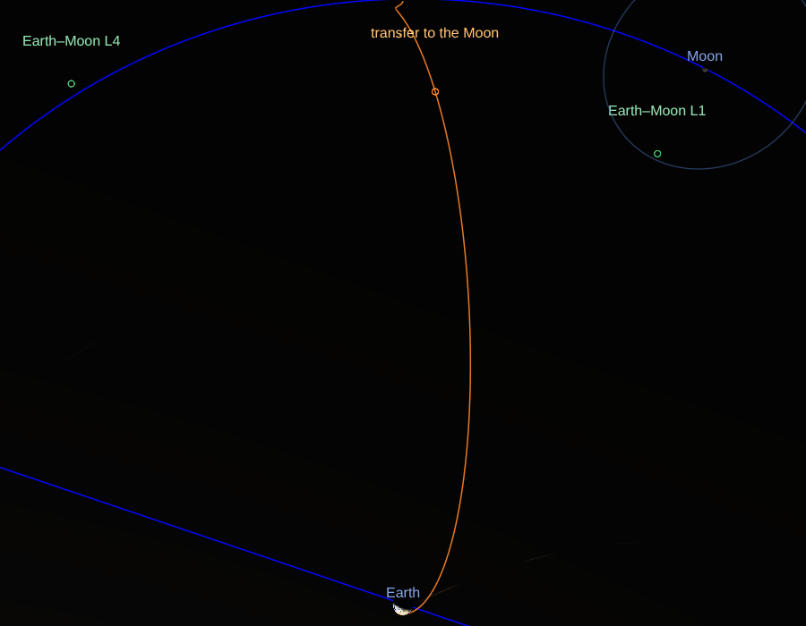
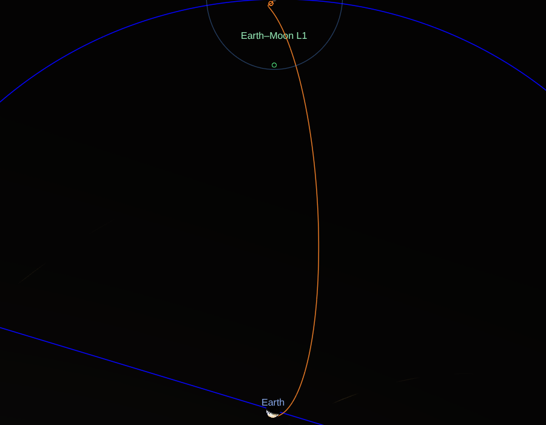

# Craft: an integrator among the bodies the app draws

A spacecraft's motion, integrated, with the planets and the Moon where the
app draws them: [#11](https://github.com/celestiary/web/issues/11) (the
integrator, in [#119](https://github.com/celestiary/web/issues/119)'s flight
simulation), and the ground for [#272](https://github.com/celestiary/web/issues/272)'s
scope 5: the low-energy transfers and the cyclers.

- `js/scene/craft/ephemeris.js`: the bodies' places as the integrator needs
  them, sampled and interpolated; `bodies.js`: the app's series it's handed
  (the Moon's, the UTC VSOP87C takes) and Horizons' frame to the app's.
- `js/scene/craft/integrator.js`: the force model and the integrators.
- `js/scene/craft/lambert.js`: Lambert's problem, the first guesses.
- `js/scene/craft/transfer.js`: a transfer from a parking orbit to the Moon,
  targeted in the full model.
- `js/scene/craft/catalog.js`: the flights the app offers, as the panel
  and the link know them; `js/scene/craft/flights.js`: how each is made
  from a departure, loaded the first time one is flown, with everything
  above it.
- `js/scene/craft/CraftTrack.js`: a flight drawn, with the craft where it is
  at the clock's time.
- `Scene.toggleCraft`, `_syncCraft`, `craftOf`; `ControlPanel.craftHtml`;
  the `craft:` link token ([design/URLs.md](../../design/URLs.md#craft-token)).

## N-body on the ephemerides, not patched conics

#11 asked for one or the other.  Patched conics (a two-body arc in each
body's sphere of influence, joined at the edges) can't make the low-energy
transfers and the manifolds' trajectories that come next: those live where
two bodies pull alike, which is what the patches leave out.  So: the craft
is integrated in the bodies' combined pull, the bodies themselves on the
app's ephemerides, never integrated.

- **The frame**: about a central body (the Earth here; the Sun for the
  cyclers), in the mean ecliptic and equinox of date, ecliptic axes, SI
  units.  The scene's frame, so a path is drawn as it is computed (turned to
  the scene's axes, (x, z, −y)).  Time is TT, as a Julian Ephemeris Day.
- **The forces** (`newForceModel`): the central body's point mass and its
  J2; each perturbing body's pull less its pull on the central body (the
  indirect term, since the frame's origin falls toward it too); and, as an
  option, the Sun's light pressure on a sphere ("cannonball": area over
  mass, a reflectivity coefficient, no shadow).  GMs are DE440's.  The
  Earth's J2 is 1.0826267e-3 on an equatorial radius of 6,378,137 m
  (EGM2008); its pole is the obliquity of J2000 from the ecliptic's, as the
  app's equator is.
- **Left out**: the other planets for cislunar flight (Venus at its closest
  pulls 2e-9 m/s² across the Earth–Moon system, Jupiter 2e-10, against the
  Sun's tide of 4e-6); the Moon's own harmonics (mascons: #272's scope 4);
  relativity; eclipses of the light pressure.

## The bodies' places

The Moon from the lunar theory (`lunarTheory.js`, Meeus's truncated
ELP-2000/82, within 4 km of Horizons), the Sun from VSOP87C's Earth turned
round, other planets from VSOP87C: the same functions that place the drawn
bodies, so a transfer ends where the drawn Moon is.  VSOP87C takes 2.2 ms a
call and the Moon's series 11 µs, and an integration asks tens of thousands
of times, so each body is sampled on an even grid as it's first needed
(`SampledTrack`) and read between samples by Lagrange interpolation of
degree 7:

| Body | Spacing | Error against the series called directly |
|---|---|---|
| Moon | 6 hours | under a metre |
| Sun, planets | 1 day | under a metre (at 2 days, 80 m: VSOP87C's Earth carries its monthly 4,700 km wobble about the Earth–Moon barycentre) |

VSOP87C is fed the UTC Julian Day, as `Animation.setDate` does, and the
Moon's series TT.  In the app the integrator gets `Animation.vsopAt`:
VSOP87C once its chunk is in, and its stand-in (`planetsApprox.js`) until
then, whose Sun is within 0.007° of it.  Nothing here imports VSOP87C, and
none of the craft's code is in the first load: the scene knows the flights
by `catalog.js` and imports `flights.js`, and so the integrator, the first
time one is flown (`Scene._flightsReady`).  Imported with the scene, it
took the first load from 705 to 713 KB gzipped.  And nothing lazy imports
a module the first load holds: esbuild puts what an entry and a dynamic
import share in a chunk of its own, and flights.js reaching the lunar
theory and the frame (and `catalog.js`) split two out, one request over
the homepage's budget.  So `bodies.js`, which needs them, is in the first
load, and the scene hands its functions to the flight (`appBodies`).

**Horizons' frame**: Horizons gives the ecliptic and equinox of J2000;
`j2000ToDate` turns a vector by the precession to the date
(`celestialFrame.precessionQuaternion`), 50.29″ a year in longitude.

## The integrators, and the energy they keep

Two kinds (`integrator.js`):

- **Dormand–Prince 5(4)**, adaptive (`dopri5`): steps bounded by an error
  estimate per component, a relative tolerance and an absolute one each for
  position and velocity.  For transfers and anything eccentric: its steps
  shrink at a flyby and grow on the way out.  It drifts in energy, slowly,
  at its tolerance.
- **Symplectic, fixed step** (`symplectic`): leapfrog (velocity Verlet,
  order 2) and Yoshida's order-4 composition of three leapfrogs, the
  Verlet family #17 discussed.  On a near-circular orbit their energy error
  stays bounded however long they run.  A whole number of equal steps, each
  ending on t0 + i·h exactly: summed, the substeps' times drift by rounding,
  and at 4e7 s a loop ending within 1e-9 s of t1 never ended.

**Measured** (the two-body problem about the Earth, 1000 orbits; the state
should return to its start after each whole period, so the miss is the
error):

| Orbit | Integrator | Worst energy error | Miss after 1000 orbits | Force evaluations |
|---|---|---|---|---|
| LEO, 400 km | Dormand–Prince, 1e-12 | 4.5e-8 | 1.4 km | 1.4 M |
| | Dormand–Prince, 1e-10 | 4.0e-6 | 126 km | 0.57 M |
| | Yoshida 4, T/200 | 1.1e-12 | 38 km | 0.6 M |
| | Yoshida 4, T/1000 | 1.8e-13 | 0.06 km | 3 M |
| | leapfrog, T/1000 | 3.9e-10 | 560 km | 1 M |
| GEO | Dormand–Prince, 1e-12 | 8.3e-9 | 1.7 km | 2.0 M |
| | Yoshida 4, T/1000 | 2.7e-13 | 0.38 km | 3 M |
| Molniya, e 0.72 | Dormand–Prince, 1e-12 | 4.9e-8 | 15 km | 2.4 M |
| | Yoshida 4, T/1000 | 2.0e-6 | 1,230 km | 3 M |
| | Yoshida 4, T/200 | 1.1e-3 | 37,400 km | 0.6 M |

- On a circular orbit the symplectic schemes keep the energy to rounding,
  and their error is all in phase: Yoshida's order 4 is the best for long
  runs of the same orbit.
- On an eccentric one a fixed step fine at apogee is far too long at
  perigee: Molniya's Yoshida T/200 loses a thousandth of its energy.  The
  adaptive integrator wins by orders of magnitude, so it's what the
  transfers use, at 1e-12 (positions to 0.1 mm absolute, velocities to
  1e-7 m/s).

**The Jacobi constant**: with the Moon put on a circle at the pair's mean
motion, the force model is the circular restricted three-body problem, and
cr3bp.js's Jacobi constant must hold.  Over a five-day translunar coast
from 185 km it holds to 2e-9 (C is 2.5 there, the difference of two terms
of 117: 2e-11 of them).

**A real craft**: TESS, in its 13.7-day orbit in 2:1 resonance with the
Moon, 108,000 to 375,000 km out, where the Moon and the Sun pull hardest.
Horizons' states (`tess.horizons.json`, `tools/craft/fetchHorizons.mjs`,
which records its query), flown three days from the start of two arcs
between momentum dumps, two weeks apart:

| Arc | Gravity alone | With light pressure, 0.015 m²/kg, Cr 1.3 |
|---|---|---|
| 2023 Mar 3–6 | 2.9 km | 0.23 km |
| 2023 Mar 17–20 | 2.8 km | 0.14 km |

The miss without it grows as t², a steady 1.3e-7 m/s²: the light pressure
on a 360 kg craft with its arrays.  The area over mass was fitted on the
first arc (0.005 to 0.03 tried) and holds the second.  A day across a
momentum dump misses by 2 to 5 km.  Artemis I, also in Horizons, burned too
often to check against.

## A transfer to the Moon

`lunarTransfer`: from a circular 185 km parking orbit in the Moon's orbit
plane, one burn, to a perilune 100 km over the Moon, in the full model (the
Earth with J2, the Moon, the Sun).

- **First guess**: Lambert's arc (`lambert.js`, universal variables;
  Vallado's example 7-5 to 1e-4 km/s) to the Moon's place at the arrival,
  from a point of the parking orbit 175° round from it (at 180° the arc's
  plane isn't defined).
- **Targets**, by Newton's method on the burn's velocity with differences:
  the perilune's height, its distance from the Moon's orbit plane, and its
  time.  Scalars of the perilune, found wherever it falls (integrated until
  the distance from the Moon stops falling inside its sphere of influence,
  then bisected), not a point: aimed at a point at a fixed time, or at the
  perilune's place, Newton's method walked the craft through the Moon,
  where the map is singular, and stalled.  Steps are capped at 50 m/s.
- **Cost**: 6 to 11 iterations, 70 to 180 ms in bun; in headless Chromium,
  250 ms from the panel's click to the drawn path.

**Checked** (`transfer.test.js`): on three dates the burn is within 1% of
the Hohmann ellipse's to the Moon's distance then (3,140 to 3,152 m/s for
4.5 days), and the path flown again from the burn passes 100 km over the
Moon.  For three days, 3,147 m/s, and a lunar orbit insertion into a 111 by
313 km orbit of 833 m/s.  Apollo 11's were about 3,185 m/s (a 5 min 20 s
burn, with its gravity losses) and 889 m/s: figures from its mission report,
quoted second-hand (nasa.gov isn't reachable from the sandbox); Apollo's
free-return path arrived faster.

## Drawn

`craft:` in the link, and the *Craft* rows of the info panel's Space around
section for the Earth and the Moon: "transfer to the Moon", with a "fly"
switch.  Switched on, it leaves
at 0h TT of the clock's day; the panel gives its date, burn, time of flight
and arrival speed.  The path is drawn about the Earth from the burn to the
perilune, in the orbits group (`o`), with a marker and its name where the
craft is at the clock's time while it's in flight (`CraftTrack.place`, from
`preAnimCb`).

In headless Chromium, leaving 2026 Oct 23 (3,149 m/s), from above the
Earth–Moon plane: 2.5 days out, the Moon still short of where the path
ends; and at arrival, the Moon's Hill sphere on the path's end.

## Not yet

- **The ballistic lunar transfer** via the Sun–Earth L1 or L2, as GRAIL's
  and CAPSTONE's, on the manifolds ([Lagrange.md, manifolds](Lagrange.md#manifolds)).
- **The cyclers**: Aldrin's Earth–Mars cycler and an Earth–Moon one.
- **Thrust, and a craft the user flies** (#2, #119).
- **The lunar orbit after the perilune**, and the parking orbit before the
  burn.
