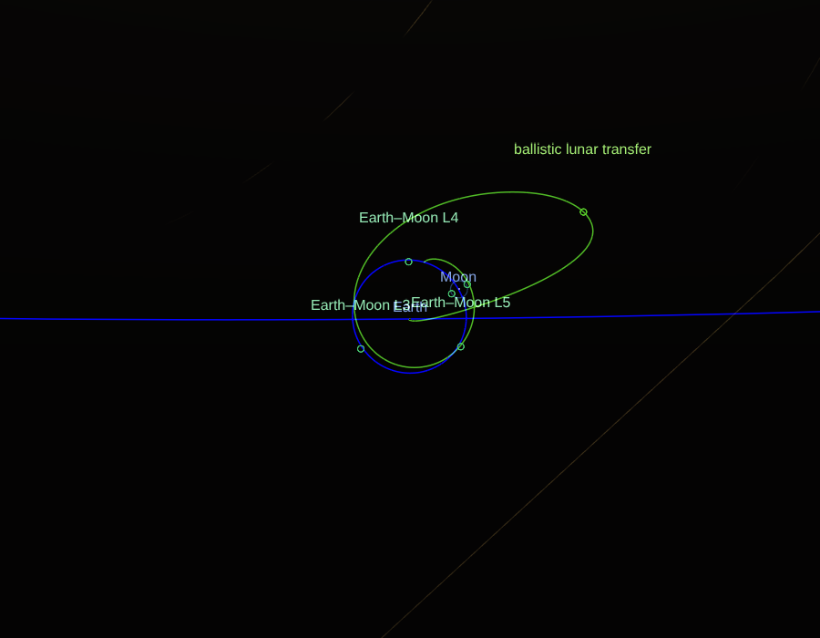
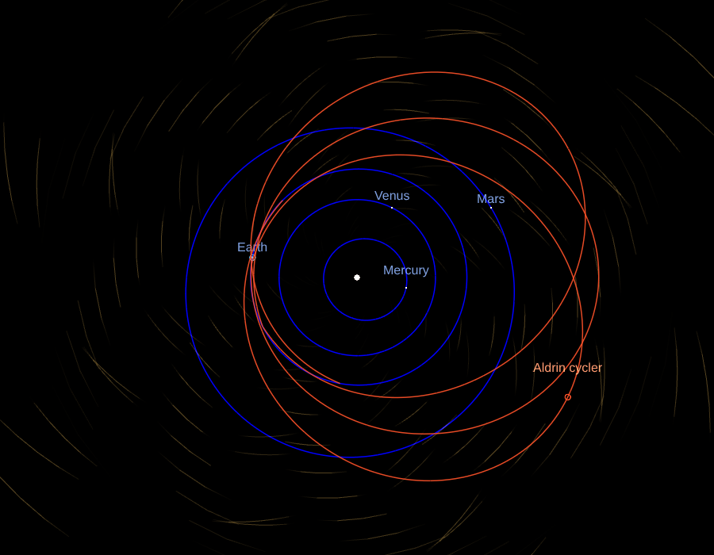
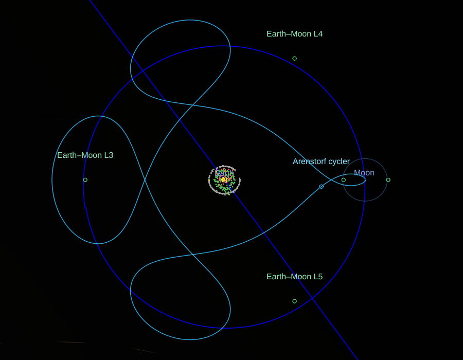
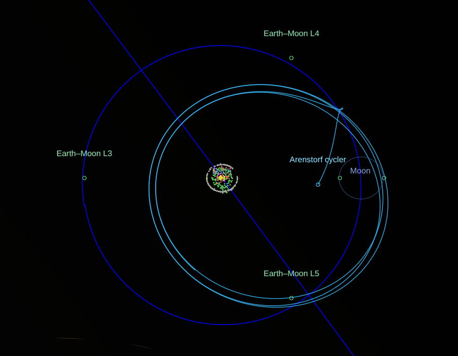

# Craft: an integrator among the bodies the app draws

A spacecraft's motion, integrated, with the planets and the Moon where the
app draws them: [#11](https://github.com/celestiary/web/issues/11) (the
integrator, in [#119](https://github.com/celestiary/web/issues/119)'s flight
simulation), and the ground for [#272](https://github.com/celestiary/web/issues/272)'s
scope 5: the low-energy transfers and the cyclers.

- `js/scene/craft/ephemeris.js`: the bodies' places as the integrator needs
  them, sampled and interpolated; `bodies.js`: the app's series it's handed
  (the Moon's, the UTC VSOP87C takes) and Horizons' frame to the app's.
- `js/scene/craft/integrator.js`: the force model and the integrators.
- `js/scene/craft/lambert.js`: Lambert's problem, the first guesses.
- `js/scene/craft/transfer.js`: a transfer from a parking orbit to the Moon,
  targeted in the full model.
- `js/scene/craft/cycler.js`: Aldrin's Earth–Mars cycler, on circles and on
  the planets as they are; `tools/craft/designCyclers.mjs` makes the ones the
  app offers (`public/data/aldrin.json`).  The Earth–Moon cycler is a
  three-body orbit ([Lagrange.md](Lagrange.md#three-body-orbits)).
- `js/scene/craft/blt.js`: the ballistic lunar transfer, designed backward
  from the Moon; `tools/craft/designBlt.mjs` makes the ones the app offers
  (`public/data/blt.json`).
- `js/scene/craft/catalog.js`: the flights the app offers, as the panel
  and the link know them; `js/scene/craft/flights.js`: how each is made
  from a departure, loaded the first time one is flown, with everything
  above it.
- `js/scene/craft/CraftTrack.js`: a flight drawn, with the craft where it is
  at the clock's time.
- `Scene.toggleCraft`, `_syncCraft`, `craftOf`; `ControlPanel.craftHtml`;
  the `craft:` link token ([design/URLs.md](../../design/URLs.md#craft-token)).

## N-body on the ephemerides, not patched conics

#11 asked for one or the other.  Patched conics (a two-body arc in each
body's sphere of influence, joined at the edges) can't make the low-energy
transfers and the manifolds' trajectories that come next: those live where
two bodies pull alike, which is what the patches leave out.  So: the craft
is integrated in the bodies' combined pull, the bodies themselves on the
app's ephemerides, never integrated.

- **The frame**: about a central body (the Earth here; the Sun for the
  cyclers), in the mean ecliptic and equinox of date, ecliptic axes, SI
  units.  The scene's frame, so a path is drawn as it is computed (turned to
  the scene's axes, (x, z, −y)).  Time is TT, as a Julian Ephemeris Day.
- **The forces** (`newForceModel`): the central body's point mass and its
  J2; each perturbing body's pull less its pull on the central body (the
  indirect term, since the frame's origin falls toward it too); and, as an
  option, the Sun's light pressure on a sphere ("cannonball": area over
  mass, a reflectivity coefficient, no shadow).  GMs are DE440's.  The
  Earth's J2 is 1.0826267e-3 on an equatorial radius of 6,378,137 m
  (EGM2008); its pole is the obliquity of J2000 from the ecliptic's, as the
  app's equator is.
- **Left out**: the other planets for cislunar flight (Venus at its closest
  pulls 2e-9 m/s² across the Earth–Moon system, Jupiter 2e-10, against the
  Sun's tide of 4e-6); the Moon's own harmonics (mascons: #272's scope 4);
  relativity; eclipses of the light pressure.

## The bodies' places

The Moon from the lunar theory (`lunarTheory.js`, Meeus's truncated
ELP-2000/82, within 4 km of Horizons), the Sun from VSOP87C's Earth turned
round, other planets from VSOP87C: the same functions that place the drawn
bodies, so a transfer ends where the drawn Moon is.  VSOP87C takes 2.2 ms a
call and the Moon's series 11 µs, and an integration asks tens of thousands
of times, so each body is sampled on an even grid as it's first needed
(`SampledTrack`) and read between samples by Lagrange interpolation of
degree 7:

| Body | Spacing | Error against the series called directly |
|---|---|---|
| Moon | 6 hours | under a metre |
| Sun, planets | 1 day | under a metre (at 2 days, 80 m: VSOP87C's Earth carries its monthly 4,700 km wobble about the Earth–Moon barycentre) |

VSOP87C is fed the UTC Julian Day, as `Animation.setDate` does, and the
Moon's series TT.  In the app the integrator gets `Animation.vsopAt`:
VSOP87C once its chunk is in, and its stand-in (`planetsApprox.js`) until
then, whose Sun is within 0.007° of it.  Nothing here imports VSOP87C, and
none of the craft's code is in the first load: the scene knows the flights
by `catalog.js` and imports `flights.js`, and so the integrator, the first
time one is flown (`Scene._flightsReady`).  Imported with the scene, it
took the first load from 705 to 713 KB gzipped.  And nothing lazy imports
a module the first load holds: esbuild puts what an entry and a dynamic
import share in a chunk of its own, and flights.js reaching the lunar
theory and the frame (and `catalog.js`) split two out, one request over
the homepage's budget.  So `bodies.js`, which needs them, is in the first
load, and the scene hands its functions to the flight (`appBodies`).

**Horizons' frame**: Horizons gives the ecliptic and equinox of J2000;
`j2000ToDate` turns a vector by the precession to the date
(`celestialFrame.precessionQuaternion`), 50.29″ a year in longitude.

## The integrators, and the energy they keep

Two kinds (`integrator.js`):

- **Dormand–Prince 5(4)**, adaptive (`dopri5`): steps bounded by an error
  estimate per component, a relative tolerance and an absolute one each for
  position and velocity.  For transfers and anything eccentric: its steps
  shrink at a flyby and grow on the way out.  It drifts in energy, slowly,
  at its tolerance.
- **Symplectic, fixed step** (`symplectic`): leapfrog (velocity Verlet,
  order 2) and Yoshida's order-4 composition of three leapfrogs, the
  Verlet family #17 discussed.  On a near-circular orbit their energy error
  stays bounded however long they run.  A whole number of equal steps, each
  ending on t0 + i·h exactly: summed, the substeps' times drift by rounding,
  and at 4e7 s a loop ending within 1e-9 s of t1 never ended.

**Measured** (the two-body problem about the Earth, 1000 orbits; the state
should return to its start after each whole period, so the miss is the
error):

| Orbit | Integrator | Worst energy error | Miss after 1000 orbits | Force evaluations |
|---|---|---|---|---|
| LEO, 400 km | Dormand–Prince, 1e-12 | 4.5e-8 | 1.4 km | 1.4 M |
| | Dormand–Prince, 1e-10 | 4.0e-6 | 126 km | 0.57 M |
| | Yoshida 4, T/200 | 1.1e-12 | 38 km | 0.6 M |
| | Yoshida 4, T/1000 | 1.8e-13 | 0.06 km | 3 M |
| | leapfrog, T/1000 | 3.9e-10 | 560 km | 1 M |
| GEO | Dormand–Prince, 1e-12 | 8.3e-9 | 1.7 km | 2.0 M |
| | Yoshida 4, T/1000 | 2.7e-13 | 0.38 km | 3 M |
| Molniya, e 0.72 | Dormand–Prince, 1e-12 | 4.9e-8 | 15 km | 2.4 M |
| | Yoshida 4, T/1000 | 2.0e-6 | 1,230 km | 3 M |
| | Yoshida 4, T/200 | 1.1e-3 | 37,400 km | 0.6 M |

- On a circular orbit the symplectic schemes keep the energy to rounding,
  and their error is all in phase: Yoshida's order 4 is the best for long
  runs of the same orbit.
- On an eccentric one a fixed step fine at apogee is far too long at
  perigee: Molniya's Yoshida T/200 loses a thousandth of its energy.  The
  adaptive integrator wins by orders of magnitude, so it's what the
  transfers use, at 1e-12 (positions to 0.1 mm absolute, velocities to
  1e-7 m/s).

**The Jacobi constant**: with the Moon put on a circle at the pair's mean
motion, the force model is the circular restricted three-body problem, and
cr3bp.js's Jacobi constant must hold.  Over a five-day translunar coast
from 185 km it holds to 2e-9 (C is 2.5 there, the difference of two terms
of 117: 2e-11 of them).

**A real craft**: TESS, in its 13.7-day orbit in 2:1 resonance with the
Moon, 108,000 to 375,000 km out, where the Moon and the Sun pull hardest.
Horizons' states (`tess.horizons.json`, `tools/craft/fetchHorizons.mjs`,
which records its query), flown three days from the start of two arcs
between momentum dumps, two weeks apart:

| Arc | Gravity alone | With light pressure, 0.015 m²/kg, Cr 1.3 |
|---|---|---|
| 2023 Mar 3–6 | 2.9 km | 0.23 km |
| 2023 Mar 17–20 | 2.8 km | 0.14 km |

The miss without it grows as t², a steady 1.3e-7 m/s²: the light pressure
on a 360 kg craft with its arrays.  The area over mass was fitted on the
first arc (0.005 to 0.03 tried) and holds the second.  A day across a
momentum dump misses by 2 to 5 km.  Artemis I, also in Horizons, burned too
often to check against.

## A transfer to the Moon

`lunarTransfer`: from a circular 185 km parking orbit in the Moon's orbit
plane, one burn, to a perilune 100 km over the Moon, in the full model (the
Earth with J2, the Moon, the Sun).

- **First guess**: Lambert's arc (`lambert.js`, universal variables;
  Vallado's example 7-5 to 1e-4 km/s) to the Moon's place at the arrival,
  from a point of the parking orbit 175° round from it (at 180° the arc's
  plane isn't defined).
- **Targets**, by Newton's method on the burn's velocity with differences:
  the perilune's height, its distance from the Moon's orbit plane, and its
  time.  Scalars of the perilune, found wherever it falls (integrated until
  the distance from the Moon stops falling inside its sphere of influence,
  then bisected), not a point: aimed at a point at a fixed time, or at the
  perilune's place, Newton's method walked the craft through the Moon,
  where the map is singular, and stalled.  Steps are capped at 50 m/s.
- **Cost**: 6 to 11 iterations, 70 to 180 ms in bun; in headless Chromium,
  250 ms from the panel's click to the drawn path.

**Checked** (`transfer.test.js`): on three dates the burn is within 1% of
the Hohmann ellipse's to the Moon's distance then (3,140 to 3,152 m/s for
4.5 days), and the path flown again from the burn passes 100 km over the
Moon.  For three days, 3,147 m/s, and a lunar orbit insertion into a 111 by
313 km orbit of 833 m/s.  Apollo 11's were about 3,185 m/s (a 5 min 20 s
burn, with its gravity losses) and 889 m/s: figures from its mission report,
quoted second-hand (nasa.gov isn't reachable from the sandbox); Apollo's
free-return path arrived faster.

## Drawn

`craft:` in the link, and the *Craft* rows of the info panel's Space around
section for the Earth and the Moon: "transfer to the Moon", with a "fly"
switch.  Switched on, it leaves
at 0h TT of the clock's day; the panel gives its date, burn, time of flight
and arrival speed.  The path is drawn about the Earth from the burn to the
perilune, in the orbits group (`o`), with a marker and its name where the
craft is at the clock's time while it's in flight (`CraftTrack.place`, from
`preAnimCb`).

In headless Chromium, leaving 2026 Oct 23 (3,149 m/s), from above the
Earth–Moon plane: 2.5 days out, the Moon still short of where the path
ends; and at arrival, the Moon's Hill sphere on the path's end.

## The ballistic lunar transfer

#272's scope 5: the low-energy way to the Moon GRAIL (2011) and CAPSTONE
(2022) flew.  From a low parking orbit the craft goes out to about 1.5
million km, toward the Sun–Earth L1 or L2; there the Sun's tide turns its
orbit and raises its perigee to the Moon's distance, and it falls back to
the Moon three to four months later almost at rest relative to it.  It
costs some 60 m/s more to leave than a direct transfer, and 100 to 250 m/s
less to stop at the Moon.  In the circular restricted problems it rides the
Sun–Earth L1 or L2 orbits' manifolds out and the Earth–Moon ones in
([Lagrange.md, manifolds](Lagrange.md#manifolds)); here it is made directly
in the full model, where the Sun's place is VSOP87C's.

**Designed backward** (`blt.js` `designBlt`), as Parker and Anderson do
(*Low-Energy Lunar Trajectory Design*, JPL DESCANSO 2014, ch. 3):

- **Fix the arrival**: its date, a perilune 100 km over the Moon, and the
  energy about the Moon there, C3 −0.02 km²/s² (nearly parabolic: GRAIL-A
  and CAPSTONE arrived at −0.03 and −0.05 in Horizons; a direct transfer
  arrives at about +0.7).
- **Scan** the perilune round the Moon in its orbit plane, every 2°, both
  ways about it, and integrate each back 170 days.  Keep those whose least
  distance from the Earth, once they have been past 800,000 km, is under
  60,000 km.
- **Newton's method** on the perilune's angle and its velocity's tilt out
  of the plane (the least step, one equation in two unknowns) puts that
  perigee at the 185 km parking orbit.  It runs at the scan's tolerance
  (1e-10) until within 100 km, then at 1e-12.
- **The Earth is a point mass through the scan**: a path through it still
  has a least distance, smooth in the parameters, where one stopped at the
  surface has the surface's, and Newton's method stalled on it.  Paths
  within 1,000 km of the centre are dropped.
- **A departure date is a preference, not a target**: given one, the
  design converges six candidates and keeps the one leaving nearest it.
  The perigee's time jumps between passes (the arc is long, and chaotic),
  and Newton's method on it as a second target didn't converge.
- **1.5 to 3 s a design** in bun, so the app doesn't design them:
  `tools/craft/designBlt.mjs` designs one arriving each week from 2026 Nov
  1 to 2028 Dec 31 (112 of 114 weeks have one, 75 to 168 days long) into
  `public/data/blt.json` (28 KB, loaded the first time one is flown).  It
  keeps the departure and its state as computed: the arc grows an error ten
  thousand-fold, and a departure rounded to a microday (0.09 s, a kilometre
  along the path at perigee) arrived 16,000 km off.

**Flown in the app** (`flights.js` `ballisticTransfer`): the first design
leaving on or after the clock's day, from its departure state to its
arrival.  It waits for VSOP87C itself (`needsVsop`): the stand-in's Sun,
0.007° off, would move the arrival.  The panel gives the departure, the
burn, how far out it goes, the days, and the burn into a circular orbit at
the Moon; past the last design, "none designed from this date".

Drawn in headless Chromium, the first design leaving after 2026 Oct 23
(97 days, 3,205 m/s, out to 1.41 million km, arriving 99.93 km over the
Moon, 672 m/s into a circular orbit there), 40% of the way, from 5 million km over the ecliptic
with the Sun up: out on the Sun's side, round, and back into the Moon's
orbit (blue) to meet it.  Switched on by its panel switch, drawn 0.7 and
2.5 s later in two runs (its data loaded, VSOP87C in, the flight flown),
and the panel's row rewritten with its facts.

**Checked** (`blt.test.js`, `blt.horizons.json` from
`tools/craft/fetchHorizons.mjs blt`, which records its queries):

- **The missions, in Horizons**: GRAIL-A left at C3 −0.71 km²/s²; both went
  out to 1.51 and 1.54 million km, about 21° off the Sun's direction; both
  arrived nearly parabolic.  CAPSTONE's farthest, 1,538,320 km on 2022 Aug
  26, is the 1.538 million km on 26 August that Advanced Space and Terran
  Orbital reported.
- **The force model where the Sun pulls as the Earth does**: CAPSTONE's
  coast, 2022 Jul 14 to 24, 0.86 million km out, flown ten days from
  Horizons' state: 29 km off without the light pressure, 9 km with 0.01
  m²/kg (a 25 kg craft), and a steady 0.6 km a day the pressure doesn't
  explain, likely its momentum dumps.
- **A design between each mission's dates**, against the mission:

| | GRAIL-A | designed | CAPSTONE | designed |
|---|---|---|---|---|
| Days | 112 | 118.5 | 132 | 123.2 |
| Farthest, million km | 1.51 | 1.57 | 1.54 | 1.62 |
| C3 leaving, km²/s² | −0.71 | −0.61 | (left a Photon stage) | −0.53 |

  Each leaves at C3 −0.45 to −0.8, burns 40 to 80 m/s more than a direct
  transfer from 185 km, goes out to within 15% of the mission's farthest,
  within 45° of the Sun–Earth line, and saves 100 to 250 m/s into a 100 km
  circular orbit (GRAIL's design saved about 130 m/s into its ellipse,
  second-hand).  Flown forward from its burn, it arrives within a kilometre
  of its 100 km perilune.
- **The designs the app offers**, two of them flown: each arrives within a
  kilometre of 100 km, 600 to 720 m/s from a circular orbit there.

## Cyclers

The last of #272's scope 5: orbits that keep meeting two bodies, for ever,
with (nearly) nothing but their gravity.

### Aldrin's Earth–Mars cycler

A craft on a solar orbit that meets the Earth every synodic period, 2.135
years, and Mars about 146 days after each Earth pass (Aldrin 1985; Byrnes,
Longuski and Aldrin, *Cycler orbit between Earth and Mars*, J. Spacecraft
and Rockets 30, 1993).  Its orbit, a = 1.60 AU, goes round in 2.02 years,
so between Earth passes it goes a little over once round; the Earth's
flyby turns its line of apsides on by the planets' 48.7° a cycle.

**Patched conics** (`cycler.js`): Lambert's arcs about the Sun between the
planets as VSOP87C has them, the craft's speed relative to each planet (v∞)
turned at a flyby.  What a planet's gravity can't do above a least height
(300 km at the Earth, 200 at Mars) is paid in Δv (`flybyDv`): a burn at
periapsis to match the speeds in and out, and a rotation of the turn left
over.  Lambert's problem got whole turns for this (`lambert(…, revs,
branch)`): one turn first, on either of its two arcs.

**On circles, as the papers have it** (`idealAldrin`): the planets on
circles in one plane, each cycle one conic from the Earth to the Earth a
synodic period later (Lambert's more energetic one-turn arc), joined at
the Earth to its own copy turned by 48.7°, the start's phase searched for
the conic to cross Mars's orbit where Mars is:

| | published | here |
|---|---|---|
| Earth to Mars, days | 146 | 145.3 |
| v∞ at the Earth, km/s | 6.54 | 6.40 |
| v∞ at Mars, km/s | 9.75 | 9.68 |
| Aphelion, AU | 2.23 | 2.224 |
| Semi-major axis, AU; period, years | 1.60; 2.02 | 1.600; 2.023 |

It passes 12,700 km from Mars, within its 577,000 km sphere of influence
(the miss read at 3-hour steps).  The Earth's flyby asks for an 80° turn,
where a 300 km pass at 6.4 km/s gives 73°: here the rest costs 830 m/s a
cycle.  The published values are from Byrnes et al. and Russell and Ocampo
(2004), as remembered: the papers weren't reachable from the sandbox, and
the tests hold them to 3 days, 0.3 km/s and 0.2 km/s.

**On the planets as they are** (`aldrinCycler`): started when Mars leads
the Earth by the ideal's angle at its start, each cycle seeded with the
ideal's 145 days to Mars and the synodic period, and all three cycles'
dates adjusted together by coordinate descent (8 days down to half a day)
for the least Δv at the flybys.  Chosen one cycle at a time instead, each
stranded the next: an Earth flyby needed 7.4 km/s.  Neither orbit being a
circle nor in one plane, no two cycles are alike.  Over the six designs
(seven windows 2026 to 2040, one without a start): v∞ 5.3 to 11.4 km/s at
the Earth and 7.0 to 13.0 at Mars (its eccentricity, 0.093, most of that),
and 270 to 3,000 m/s at the flybys over three cycles, by window, nearly all
of it at the Earth's (the Mars passes are free but in one window, 705 m/s).  Half a second a design.  `tools/craft/designCyclers.mjs`
keeps each design's dates (`public/data/aldrin.json`, 4 KB); the app makes
its arcs again from them (a few Lambert solutions, VSOP87C at a few dates)
and flies each about the Sun alone, a Kepler arc, from its start.

**Drawn** about the Sun: "Aldrin cycler" in the *Craft* rows of the Earth's
and Mars's Space around sections; the first design starting on or after the
clock's day, waiting for VSOP87C; the panel gives its departure, its Mars
pass and their v∞, its cycles and what its flybys cost.  `craft:aldrin=…`.
From 6 AU over the ecliptic, 400 days in, the Sun's glare off: three
ellipses from the Earth's orbit out past Mars's, their apsides turning.

### An Earth–Moon cycler: Arenstorf's orbit

A ballistic path that keeps cycling from a pass close over the Moon to a
loop round the Earth and back: Arenstorf's periodic orbit (1963), in the
circular restricted problem, the classic test of an integrator (Hairer,
Nørsett and Wanner, *Solving Ordinary Differential Equations I*, II.0).
It's a three-body orbit, so it's a family of the Earth–Moon pair's
([Lagrange.md, three-body orbits](Lagrange.md#three-body-orbits)): the info
panel's "Arenstorf cycler", `periodic:moon=are`.

- **As published**: from (0.994, 0) in his mass ratio 0.012277471, vy0
  −2.00158510637908…, period 17.0652165601579625…  One period from his
  start returns to it to 2e-10, and the symmetric correction (its fourth
  crossing of the Earth–Moon line, at right angles, at half its period)
  gives his period to 6e-11.
- **At the Earth–Moon pair**: continued from his μ to the pair's in eight
  steps, its start kept as far from the Moon.  74.2 days round; 676 km over
  the Moon, and 178,000 km from the Earth at its nearest.
- **Fixed in space** it is swept over its own period, not the pair's turn,
  in 2,881 points: its 74-day spirograph.

A cycler of the kind the papers on Earth–Moon cyclers mean, with a low
Earth pass each period too (Casoliva et al. 2010; Uphoff and Crouch 1991),
would need their families: a free return from the Earth–Moon line can't
come back to it at right angles behind the Moon three days later, as the
Moon has moved on 40°, and a scan of perigee speeds found only orbits that
turn round past 2 separations.

Turning with the pair, and fixed in space:

**Checked** (`cycler.test.js`, `periodicOrbits.test.js`, `lambert.test.js`):
the flyby's cost (free within the turn the planet gives, the rest rotated;
a burn under the speeds' difference); one-turn Lambert arcs on both
branches landing to 1e-8 AU (the high branch over 780 days is a = 1.60 AU);
the ideal cycler against the table; a cycler on VSOP87C, its Mars passes
under 100 m/s, v∞ in range, each cycle within 30 days of the synodic
period; the designs offered, flown; Arenstorf's orbit as published and at
the pair.

## Not yet

- **The ballistic lunar transfer in the Sun–Earth turning frame**, where its
  loop out toward L1 or L2 reads as the textbooks draw it.
- **The cyclers flown in the full model**: the arcs are Kepler's; each
  flown with every planet's pull would need its correction at each pass.
- **Earth–Moon cyclers with low Earth passes** (above).
- **Thrust, and a craft the user flies** (#2, #119).
- **The lunar orbit after the perilune**, and the parking orbit before the
  burn.
