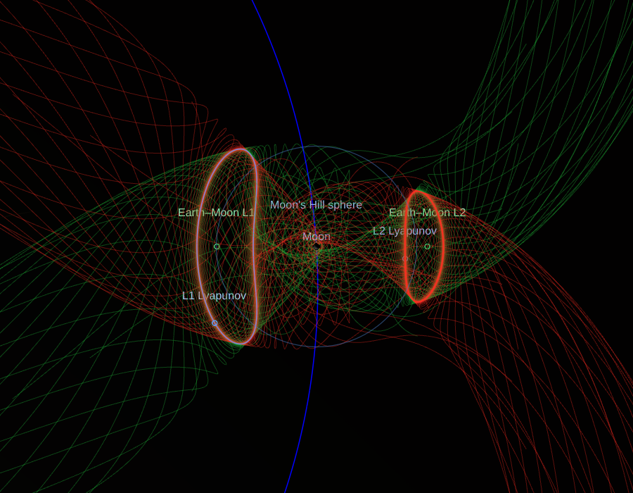
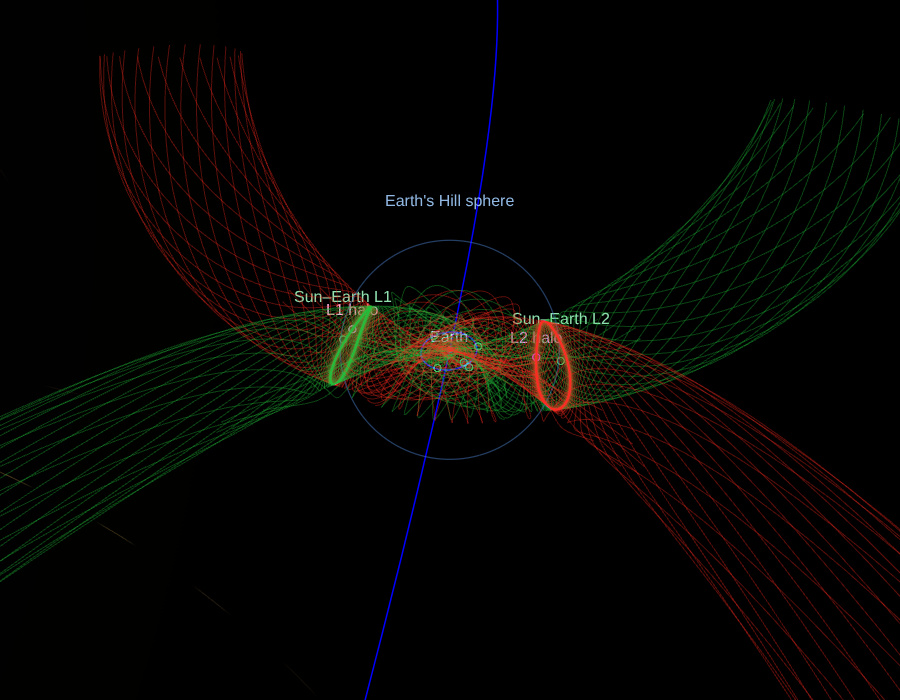

# Lagrange points, Hill spheres, synchronous orbits, orbital regimes, three-body orbits and their manifolds

The space around a pair of bodies, a primary and the secondary that orbits
it: the Sun and a planet, a planet and a moon, Pluto and Charon; and the
regimes around a body that spacecraft use.  The first three parts of
[#272](https://github.com/celestiary/web/issues/272): its scope 1, the
analytic features every pair has; its scope 2, Earth's orbital regimes and
their analogues ([below](#orbital-regimes)); and its scope 3, the
three-body periodic orbits, in the turning frame or fixed in space
([below](#three-body-orbits)); and the first of its scope 5, the invariant
manifolds of the halo and Lyapunov orbits ([below](#manifolds)), the base of
the low-energy transfers.

- `js/scene/lagrange.js`: the math, no scene.
- `js/scene/LagrangeMarks.js`: a pair's marks, drawn.
- `Scene.lagrangePairsOf`, `_syncLagrange`, `pairFacts`, `spaceAround`: which
  pairs show, and their numbers.
- `Animation.layLagrange`: laying them on the pair each frame.
- `ControlPanel.spaceListHtml`: the info panel's *space around* list.

## What's drawn, and when

For the target, its pair with its primary and its pair with its most
massive moon (`lagrangePairsOf`). The Earth shows Sun–Earth and Earth–Moon,
the Moon Earth–Moon, the Sun Sun–Jupiter, Tethys Saturn–Tethys. A pair's
marks are made the first time it's wanted and taken out of the scene when
the target moves on. They're in the orbits group (`o`): they fade with the
orbit lines, and `s=o` in a link hides them.

- **The five points**: small rings, a fixed size on screen, named
  "Earth–Moon L1" and so on.
- **The secondary's Hill sphere**: its outline as the camera sees it
  (`overlayMarks.js` `faceOutline`: the circle where the lines of sight
  graze the sphere, R²/d nearer the eye than the centre and of radius
  R √(1 − R²/d²), so it stays on the true outline up close), named at its
  edge on the orbit's pole side.
- **The synchronous orbit**, where the body can hold one: a ring in its
  equator (under its `planetTilt`), named "geostationary orbit",
  "areostationary orbit" or "synchronous orbit"; the panel gives its radius.
  The radius, not the altitude: the descriptors' radii are mean radii, and
  an altitude over Earth's mean radius isn't GEO's familiar 35,786 km,
  which is over the equator.
- **Labels are short**: a label sprite is a square as wide as its text, with
  the text at its top, so it stands above its point by half its width (a
  40-character label, 160 px). Descriptions go in the panel.
- **Labels only where they can be told apart** (`LagrangeMarks._declutter`):
  an L1 or L2 label shows when its distance from the secondary spans 50 px
  on screen, L3 to L5 when the pair's separation does, the Hill sphere's
  and the synchronous orbit's when their radii do; the points show when the
  pair spans 12 px. From afar, Sun–Earth's L1 and L2 are named and
  Earth–Moon's L1 and L2 aren't, until you come in.
- **The info panel's *space around* list** gives the Hill radius, the pair's
  L1 and L2 distances (at the mean distance), and the synchronous orbit or
  why there's none.

## The model

The circular restricted three-body problem (CR3BP).  μ = m / (M + m), the
secondary's share of the pair's mass; the secondary's mass includes its
moons (the Earth with the Moon, Pluto with Charon), so the Sun–Earth pair is
the Sun and the Earth–Moon barycentre.

- **L1, L2, L3** are the roots of Szebehely's quintics in μ (*Theory of
  Orbits*, 1967, §4.5), by Newton's method from the Hill approximation
  ∛(μ/3) for L1 and L2 and 1 − 7μ/12 for L3.  L1 and L2 are measured from
  the secondary, L3 from the primary.  `lagrange.test.js` checks Szebehely's
  Earth–Moon values to 1e-6, and the force balance at all five points for μ
  from 1e-12 to 0.5.
- **L4 and L5** are the equilateral points, 60° ahead of the secondary and
  60° behind.
- **The pulsating frame.**  The points are placed along the secondary's place
  of the moment from the primary, scaled by its distance of the moment, and
  in its orbit's plane of the moment.  The pole comes from the body's
  elements now (`Animation.orbitElements`): osculating for the planets and
  the Moon, the mean elements for the moons.  So the points follow the
  real, eccentric, perturbed orbits the ephemerides draw (VSOP87C, the
  lunar theory).  For the Sun–Earth pair the line is the Earth–Moon
  barycentre's, and the Hill sphere is centred on the Earth.
- **The Hill radius** is a (1 − e) ∛(μ/3), at pericentre: the issue's form,
  a fixed size.  It differs from the L1 distance by under a few per cent.
- **The synchronous orbit** is ∛(GM P² / 4π²), with G·m from the
  descriptor's mass and P its sidereal rotation period.
  `synchronousOrbit` says when a body can't hold one:
  - `inside` the body;
  - `beyondHill`, past the Hill sphere, where the primary's tide takes it
    away: Mercury and Venus (slow rotators), the Moon (selenosynchronous at
    88,460 km, past its 57,900 km Hill sphere), and every tidally locked
    moon, whose synchronous orbit is ∛3 times its Hill radius.

  Mars's areostationary orbit, 20,428 km from the centre, lies between
  Phobos and Deimos, as it should.

## Checked against real co-orbitals

`js/scene/lagrange.horizons.json` holds JPL Horizons state vectors, from
`tools/lagrange/fetchHorizons.mjs`, which records its query.  They cover
each pair's secondary and the bodies at its points, relative to the
primary, at 1950, 2000, 2026 and 2050.  `lagrange.test.js` places the points
from the secondary's state and measures each body's longitude from its
point in the orbit plane:

| Body | Point | Worst over the four dates |
|---|---|---|
| Telesto | Saturn–Tethys L4 | 1.1° |
| Calypso | Saturn–Tethys L5 | 3.6° |
| Helene | Saturn–Dione L4 | 15° (it librates widely) |
| Polydeuces | Saturn–Dione L5 | 31° (its libration is ±30° and more) |
| Achilles, Hektor | Sun–Jupiter L4 | 18°, 19° |
| Patroclus, Aeneas | Sun–Jupiter L5 | 9°, 16° |
| 2010 TK7 | Sun–Earth L4 | ahead of the Earth at every date; its tadpole spans most of the orbit, so only the side is checked |

`Animation.lagrange.test.js` checks the laying: the pole is the real r × v
to under 0.01° (0.1° for a moon on mean elements), L4 is the side the body
is moving toward, and the Sun–Earth line is the barycentre's.

In the browser (headless Chromium, 2026 Oct 22), with the Earth as the
target:

- Sun–Earth L1 and L2 were 1,487,661 and 1,503,425 km from the Earth's
  centre.
- Earth–Moon L1 and L2 were 58,797 and 65,380 km from the Moon.
- L4 and L5 were on the Moon's orbit line, 60° either side.
- GEO was 42,164 km.

## Not yet

- **Search and `goTo`** for the points ("Earth-Moon L2") need targets that
  aren't bodies.
- **A setting of their own**: they're in `o` for now.
- **The rest of #272**: the Moon's frozen orbits (scope 4); the cyclers
  and transfers wait on the integrator (#11).

## Orbital regimes

#272's scope 2: the regions spacecraft use around a body, Earth's first,
and their analogues where the physics carries over.

- `js/scene/regimes.js`: the table (`REGIMES`) and the math.
- `js/scene/RegimeMarks.js`: a body's regimes, drawn.
- `Scene._syncRegimes`, `regimesOf`: which body's show, and the panel's lines.
- `Animation.layRegimes`: turning the sun-synchronous orbits to the Sun.

They show for the target, in its equator (under its `planetTilt`), in the
orbits group (`o`), as the Lagrange points do. Altitudes are over the
equatorial radius (6,378,137 m for Earth), the reference GEO's 35,786 km
uses.

**Earth's:**

- **Shells**, drawn as a faint band between the shell's inner and outer
  outlines as the camera sees them (`faceOutline`'s geometry, both edges).
  A band isn't drawn from inside its shell.
  - LEO, 160 to 2,000 km up.
  - MEO, 2,000 km to GEO's 35,786 km.
- **Boundaries**, drawn as outlines:
  - **100,000 km up**, where the cislunar explainer behind #272 says the
    Moon's pull starts to matter. The video's auto-transcript names it
    something like "warden line"; searches found no source for that name,
    so it isn't used.
  - **Cislunar space**, out to the Earth–Moon L2, 1.168 of the Moon's
    distance. The 2022 US definition is the volume beyond GEO under the
    Earth's and the Moon's gravity, the Earth–Moon Lagrange points within
    it. The transcript's "torus" wasn't found in any source either, so the
    boundary is a sphere.
- **Orbits**, as ellipses in the equator's frame, Ry(Ω) Rx(i) Ry(ω) as the
  orbit diagram's:
  - **The GEO graveyard**, 300 km above GEO (with the GEO ring from the
    Lagrange marks beside it).
  - **GPS**: six planes at 55°, 26,560 km from the centre (20,200 km up),
    half a sidereal day.
  - **Molniya** (a 26,554 km, e 0.722) and **Tundra** (a 42,164 km,
    e 0.268): 63.4°, ω 270°, apogee over the north; periods of half a
    sidereal day and one. Their nodes are illustrative: in space they keep
    their ground tracks, which a fixed node in the inertial frame doesn't.
  - **Sun-synchronous, 700 km, dawn–dusk**: the inclination at which J2
    turns the node at the Sun's mean motion,
    cos i = −(2/3) n☉ a^(7/2) (1 − e²)² / (J2 R² √GM), 98.2° (Vallado's
    98.19°); its node is put at 6 pm local time each frame
    (`nodeForLocalTime`), so its plane follows the terminator.

**Mars's:** its areostationary orbit is the Lagrange marks' synchronous
orbit; its sun-synchronous orbit (J2 1.96045e-3) at 300 km and 3 pm, as
Mars Reconnaissance Orbiter's, is 92.7° (MRO's 92.65° at about 290 km).

**Checked:**

- `regimes.test.js`: the sun-synchronous inclinations (98.19° at 700 km,
  98.6° at 800 km, MRO's 92.65°), none past the height where J2 can't turn
  the node fast enough, the families' periods, Molniya's apogee, and the
  node's local time.
- `Scene.test.js`: which body's show and where, cislunar space at 1.168 of
  the Moon's distance, the GPS planes, a dawn–dusk orbit's pole within
  0.95 of the Sun's direction, and the panel's lines.
- `Animation.lagrange.test.js`: the Sun's direction in the equator.
- In the browser (headless Chromium, 2026 Oct 22 12:00 UTC), all 19 of
  Earth's programs and Mars's 2 compile, and the dawn–dusk orbit's pole was
  0.9987 along the Sun's direction (i = 98.19°).

## Three-body orbits

#272's scope 3: the periodic orbits about a pair's Lagrange points, made in
the circular restricted three-body problem (CR3BP) and drawn on the pair as
it is.

- `js/scene/cr3bp.js`: the CR3BP in the pair's turning frame (units of the
  separation, the mean motion and the total mass), an adaptive
  Dormand–Prince integrator carrying the state-transition matrix, and the
  differential correction that closes an orbit symmetric about the xz plane
  (`correctSymmetric`: from (x0, 0, z0, 0, vy0, 0), two of x0, z0, vy0
  adjusted so the orbit next crosses y = 0 at right angles; a planar orbit
  adjusts vy0 alone).
- `js/scene/periodicOrbits.js`: the families, their first guesses, the
  sampling and the sweep in space.
- `LagrangeMarks.setFamily`, `_placeFamilies`; `Scene.togglePeriodic`,
  `setPeriodicFrame`, `periodicPairsOf`, `_syncPeriodic`;
  `ControlPanel.periodicHtml`: drawing, state and the panel's switches.

**The families**, one member each at every pair, sized against the
secondary's L1 distance γ so a family looks alike everywhere:

| Family | First guess | Member |
|---|---|---|
| L1, L2 Lyapunov (planar) | the linear solution at 0.01 γ, then x0 stepped out (continuation, each step predicted from the last two) | x amplitude 0.2 γ |
| L1, L2 halo (southern) | Richardson's third-order approximation (Richardson 1980; Koon, Lo, Marsden and Ross, appendix) | z amplitude 0.25 γ |
| Distant retrograde (DRO) | a retrograde two-body circle about the secondary at 0.2 γ, stepped out | 1.2 γ beyond it on the x axis (Earth–Moon: about 74,000 km, near Artemis I's) |
| 9:2 NRHO, Earth–Moon only | Gateway's southern NRHO at apolune, (1.0221, −0.1821, −0.1033) | its period pinned to 2/9 of a synodic month by a secant on x0 |

The links name them `l1l`, `l2l`, `l1h`, `l2h`, `dro`, `nrho`
([design/URLs.md](../../design/URLs.md#periodic-token)).

- **Richardson's guess misses by a fixed amount**: 160 km at Earth–Moon L1
  and 500 km at L2 (under 1% of γ), however small z gets, because a halo
  family begins at a finite x amplitude where the third order isn't exact.
  The correction takes it from there in a few iterations.
- **Lyapunov orbits need the continuation**: from the full size, the linear
  guess converged on another orbit (Earth–Moon L2's passed 1,663 km from
  the Moon's centre, inside it).

**Drawn on the pair.**  Each member is sampled over one period at the
integrator's own steps (densest where it moves fastest: the NRHO's
perilune), primary-centred.  The pair's frame (`LagrangeMarks.periodic`) is
laid each frame on the pair as the ephemerides have it: +X along the
secondary's place, scaled by its distance (the pulsating frame), +Y its way,
+Z its pole, as the Lagrange points are.  A marker shows where a body on
the orbit is now: its phase is the pair's turn since J2000 at its mean
motion, from the orbit's crossing of the xz plane (an illustrative epoch).

- **Turning with the pair** (the default): the orbit as its shape is
  known, fixed against the pair.
- **Fixed in space** (`inertialSweep`): the orbit as a body on it runs over
  one turn of the pair from now, each place turned on about the pole by the
  time since now. This is the spirograph the explainer video describes.
  It's swept again each frame the time moves (721 points).

**On request.** Families are off until switched on in the info panel's
*space around* list ("three-body orbits, Earth–Moon: …"), with the frame
switch below them. They're kept by pair (its secondary) for the link,
and show whenever that pair is one of the target's. A member is made the
first time it's asked for and kept: 3 to 150 ms each in bun; all six of
the Earth–Moon pair took 1.65 s in headless Chromium.

**Checked** (`cr3bp.test.js`, `periodicOrbits.test.js`):

- The Lagrange points are equilibria of the equations.
- The Jacobi constant holds to 1e-9 over 20 time units.
- The state-transition matrix matches finite differences.
- Every family closes at the Earth–Moon pair, Jupiter–Europa and
  Saturn–Enceladus: one period returns to the start within 1e-8 of the
  separation. No orbit except the NRHO comes within a tenth of a Hill
  radius of the secondary.
- The small L1 Lyapunov orbit's period is 2π/λ (λ = 2.3344, Szebehely).
- The DRO is retrograde about the secondary.
- **The 9:2 NRHO** has period 2/9 of the synodic month (6.562 d) and
  Jacobi constant 3.047, as Davis et al. 2022's CR3BP table gives.
  - Its perilune radius is 3,225 km, within the 15-year Gateway reference
    ephemeris's 3,200–3,550 km.
  - Its apolune is 70,000 km.

**JPL's catalogue, drawn where it has the pair.**  `public/data/periodicOrbits.json`
holds, for each system JPL's three-body periodic orbit catalogue has
(`ssd-api.jpl.nasa.gov/periodic_orbits.api`: Earth–Moon, Sun–Earth,
Sun–Mars, Mars–Phobos, Jupiter–Europa, Saturn–Enceladus, Saturn–Titan),
the catalogue's member matching each of the app's families: the one at the
same Jacobi constant whose crossing of the xz plane is nearest the app's,
or for the NRHO the one at the same period.
`tools/periodic/fetchJpl.mjs` builds it and records its queries:
`bun tools/periodic/fetchJpl.mjs > public/data/periodicOrbits.json`. The
app loads it the first time a family is switched on (`Scene.loadPeriodicData`)
and draws the catalogue's member, in the catalogue's mass ratio, where it
has one (`samples.source` 'JPL'). It draws its own for the other pairs,
and everywhere if the file can't be had. It's 16 KB.

- **The NRHO is matched by its period in units of the pair's turn**, not in
  days. The catalogue's time unit (382,981 s) makes the pair's turn 27.85
  days, not the Moon's 27.32, so its 6.56-day member is another orbit
  (C 3.0489). The member at 2/9 of a synodic month in turn units is at
  C 3.04667, against the app's 3.04665 and Davis et al.'s 3.047.
- **Halos are drawn as their southern twin** (`southern`: the crossing
  farthest from the plane is below it). Every southern member of the
  catalogue is that way but Titan's L1, which is listed as its northern
  mirror image.
- **Where the catalogue's family doesn't reach the app's size:**
  - Enceladus's DRO is past the catalogue's: its nearest member's period is
    53% longer, so it's listed `unmatched` and the app draws its own.
  - Phobos's L1 halos stop just short: the catalogue's last member is drawn
    (`edge`), 5% of γ (1 km) larger.

**Checked against it** (`periodicOrbits.test.js`, 35 members in seven
systems):

- Every catalogue member closes under this integrator to 1e-8 of the
  separation, and its Jacobi constant is as listed.
- The app's own members match:
  - periods within 0.2%;
  - Jacobi constants within 1e-4;
  - crossings within 1.5% of γ, or twice the catalogue's own spacing
    there (10% at the family's edge).

Not yet:

- **Other members of a family:** a slider along the family (amplitude, or
  Jacobi constant) would reuse the continuation here.

## Manifolds

The first of #272's scope 5: the stable and unstable invariant manifolds of
the L1 and L2 Lyapunov orbits and halos, at any pair.  A manifold is the set
of trajectories that wind onto the orbit (stable) or off it (unstable) with
no thrust: tubes that reach from the orbit into the primary's realm and the
secondary's.  They are why a craft can reach a halo orbit, or leave one,
for nearly nothing, and the low-energy transfers (the next part) are built
from them (Koon, Lo, Marsden and Ross, *Dynamical Systems, the Three-Body
Problem and Space Mission Design*, ch. 4 to 6; Gómez et al. 2001).

- `js/scene/manifolds.js`: the math, in cr3bp.js's units and frame.
- `LagrangeMarks.setManifolds`; `Scene.setPeriodicManifolds`, `_tubes`;
  `ControlPanel.periodicHtml`: drawing, state and the switch.

**From the monodromy matrix.**  Over one period the state-transition
matrix (cr3bp.js carries it) is the monodromy matrix M.  Its eigenvalues
come in reciprocal pairs (the flow is symplectic): 1 and 1 (along the orbit
and across the family), a pair on the unit circle (the halo's) and a real
pair λ, 1/λ, the unstable and stable directions.

- **λ by power iteration**: it is hundreds to thousands, so M v converges on
  its eigenvector in a few steps.  The stable one is the dominant
  eigenvector of M over a period *back* (`monodromy(mu, member, true)`), not
  of M inverted: M's condition is λ², a million and more, and an inverse by
  elimination lost the stable direction outright at Sun–Earth.
- **Carried along the orbit** by the state-transition matrix to 24 points
  evenly spread in time (`manifoldSeeds`): Φ(t) v.  Each is carried the way
  it grows, the unstable one forward from the start and the stable one back
  from a period on: carried the other way a direction shrinks while the
  integrator's error along the other grows, as e^(2σt).
- **A step off the orbit** of 5 × 10⁻⁴ of the secondary's L1 distance γ
  along each direction (about 30 km at Earth–Moon; Koon et al. use 200 km),
  either way: the *interior* branch leaves toward the primary, the
  *exterior* away from it.  The unstable branches are integrated forward,
  the stable ones back, each for three quarters of the pair's turn (20 days
  at Earth–Moon, 9 months at Sun–Earth), or until they meet a body's
  surface (`radii`, in units of the separation).  Four branches of 24
  trajectories each.
- **The 9:2 NRHO and the DRO get none**: the DRO is stable and the NRHO
  nearly so (stability index 1.3, against hundreds for the halos and
  Lyapunov orbits), which is why Gateway's orbit was chosen.  Its tubes
  barely leave it.

**Drawn** in the pair's frame, as the family's orbit, stable green and
unstable red as Koon et al. draw them: each kind one set of thin, faint
line segments (one draw call; the wide-line strip joins every vertex to the
next, so it can't hold many trajectories).  Turning with the pair only: a
tube is a set of trajectories leaving the orbit at every phase, and has no
one picture fixed in space.  On request, with the *Manifolds* row's switch
under the info panel's three-body orbits, and in the link as the
`periodic:` token's `manifolds` flag
([design/URLs.md](../../design/URLs.md#periodic-token)).  A family's tubes
are made the first time they're asked for and kept: 30 to 65 ms a family in
bun; in headless Chromium, Earth–Moon's two Lyapunov orbits' took 168 ms and
Sun–Earth's two halos' 100 ms.

At the Earth–Moon pair, from above (headless Chromium, 2026 Oct 22): the L1
and L2 Lyapunov orbits' tubes, the interior branches reaching toward the
Earth and the exterior ones into the Moon's realm and past it; and Sun–Earth's
halos, from Earth's Hill sphere out:

**Checked** (`manifolds.test.js`):

- **λ against the linear theory**: for an L1 Lyapunov orbit 0.5% of γ
  across, λ is e^(σT), σ = 2.9321 the saddle's rate at Earth–Moon L1 and T
  its period, to 0.1% (2,674.6 against 2,676.4).
- **The eigenvectors**: M v = λ v; M w = w / λ to 1e-8; λ times the stable
  eigenvalue is 1 to 1e-4 for all four families at Earth–Moon and
  Sun–Earth, each with a stability index over 300.
- **The directions as the flow has them**: at six points about an L2 halo,
  a step of 1e-6 along the unstable direction grows λ-fold over a period
  (to 10%), and one along the stable direction shrinks at least 200-fold,
  the floor of the integrator's error and the second order's.
- **The 9:2 NRHO's stability index** is between 1 and 2 (Zimovan-Spreen,
  Howell and Davis 2020: near 1).
- **The branches**: the interior ones leave toward the Earth and the
  exterior ones toward the Moon; each keeps the orbit's Jacobi constant to
  1e-6; the L1 exterior branch meets the Moon within the run.

The low-energy transfers that ride these tubes, flown in the full model:
[Craft.md, the ballistic lunar transfer](Craft.md#the-ballistic-lunar-transfer).

