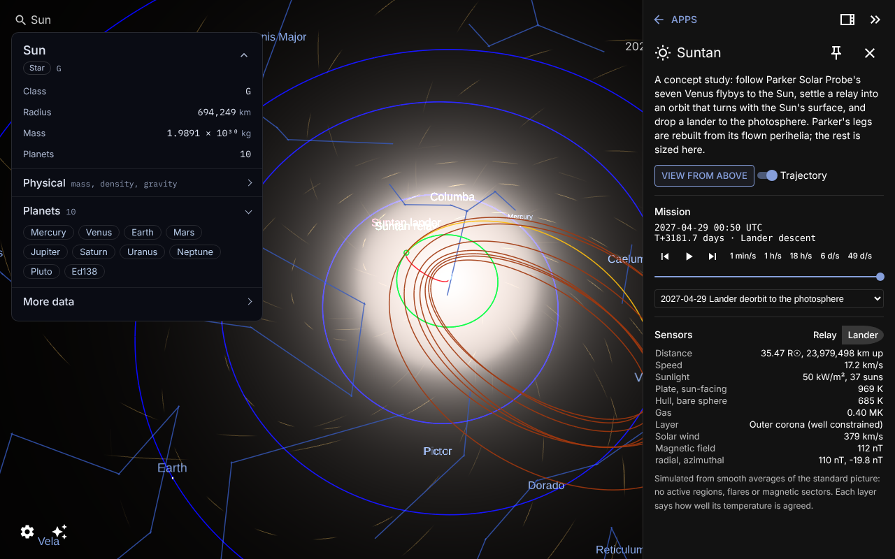
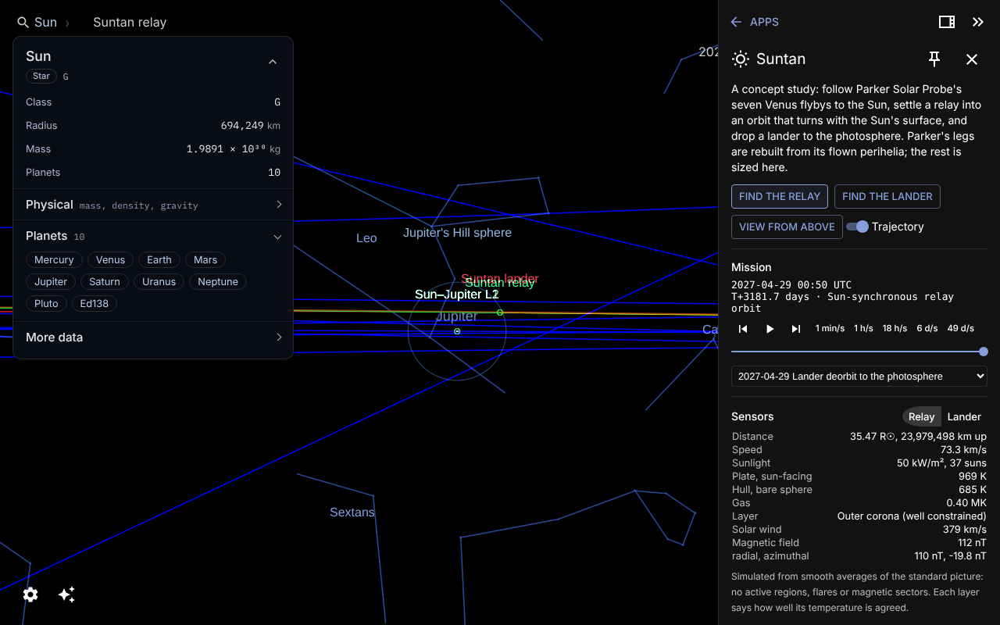

# Suntan: a concept mission to the Sun's surface

Suntan is a concept study, run as an app in the widgets drawer: fly Parker
Solar Probe's trajectory to the Sun, settle a relay into an orbit that turns
with the Sun's surface, and drop a lander to the photosphere.  The app draws
the whole mission about the Sun, plays it on the app's clock from event to
event, and reads the relay's or the lander's simulated sensors: sunlight,
temperatures, the solar wind and the magnetic field.

The research behind it, the generated trajectory numbers and a CAD model of
the flight system are in [design/suntan/](../../../design/suntan/):

- [psp-working-study.md](../../../design/suntan/psp-working-study.md): what
  Parker has flown and measured, the solar atmosphere by height with how well
  each temperature is agreed, and the condensed-surface proposals, laid out
  neutrally (the study entertains them on purpose).
- [trajectory.md](../../../design/suntan/trajectory.md) and its two plots,
  written by `bun tools/suntan/report.mjs` from the model below.
- [cad/](../../../design/suntan/cad/README.md): a STEP (AP214) assembly of
  the relay orbiter and its sling wheel of four landers, for
  [Bldrs Share](https://bldrs.ai/share), with its generator and its checks
  against Share's engine.

## The files

- `kepler.js`: two-body tools in SI units on plain arrays (Kepler's
  equation, orbits from apsides or a state, a state at a time, times even in
  eccentric anomaly for drawing).  Lambert's problem is `craft/lambert.js`'s.
- `mission.js`: the mission as a chain of legs, `stateAt(t, vehicle)`, the
  burns and the comparison numbers; also sunlight and the equilibrium
  temperatures.
- `sensors.js`: what an instrument would read at a state.
- `events.js`: the mission's named moments, for the panel's stepping.
- `SuntanTrack.js`: the mission drawn; `install.js`: built into the scene.
- `ui/SuntanApp.jsx`, `store/suntanApp.js`: the panel, and its state and
  `apps.suntan` token ([design/URLs.md](../../../design/URLs.md#appssuntan)).

## The model

Unix seconds, metres, the mean ecliptic and equinox of date, the scene's
frame (drawn turned to the scene's axes, (x, z, −y)).  Three kinds of leg,
with different standing:

1. **Launch to Venus flyby 1 is solved**: a Lambert arc from Earth at
   Parker's launch to Venus at its first flyby.  The departure energy is an
   output: C3 = 152.5 km²/s² against Parker's about 154.
2. **Parker's seven orbit families are reconstructed** from its flown
   perihelion times and distances: each family's period from its first and
   last perihelion, its orientation whatever puts the craft on Venus's
   bearing at the flybys that bound it.  Nothing forces the legs to meet at
   Venus, so how closely they do is the check: within 34,000 km at all
   seven, with the Venus-relative speed kept through each (an unpowered
   flyby can only turn it).  Fed flyby dates five days off (sources disagree
   on three), the same model misses by 3 to 9 million km, so it settles the
   disagreement (`mission.test.js`).  It isn't a forward-propagated design,
   and it doesn't resolve a flyby's altitude.
3. **The Suntan phase is sized**, impulsive burns between coplanar
   ellipses: raise perihelion to the synchronous radius at aphelion,
   circularize there, then the lander's deorbit to the photosphere.

**The planets' places are `planetsApprox`'s**, handed in by the scene
(install.js), not VSOP87C's: the same mission whether or not the series has
loaded, and the one the tests and the report build.  Its Venus is within a
few arcminutes of VSOP87C's (DESIGN.md
[before the ephemeris loads](../../../DESIGN.md#before-the-ephemeris-loads)),
invisible at the paths' scale.  Velocities are a central difference over an
hour (`planetStates`).

**Simplifications**: every leg after the first flyby lies in Venus's orbital
plane (3.39° to the ecliptic; Parker's is 3.4°), and the Sun's equator is
taken as lying in it too (it is 7.25° from the ecliptic).  The Sun rotates
differentially; the relay matches the equator's sidereal 24.47 days
(Snodgrass and Ulrich 1990), the rate `SolarWind.js` winds its spirals at.
After arrival the lander co-rotates with the photosphere; nothing models the
entry itself.

## What the numbers say

The generated tables are [trajectory.md](../../../design/suntan/trajectory.md).

- **The synchronous orbit is at 35.5 R☉ (0.165 AU), almost exactly Parker's
  first perihelion** (35.66 R☉).  The relay needs a lower aphelion, not a
  lower perihelion, and Venus can't give it: every Venus-flyby orbit still
  reaches Venus.  From Parker's final orbit it costs 29.5 km/s (22.2 km/s
  circularizing at the first perihelion instead); Parker carries a few
  hundred m/s.
- **Every route to the photosphere arrives at about 610 km/s**, the Sun's
  escape speed less a little: set by the well, not the route.
- **A minimum-energy descent arrives level, not falling**, and lands out of
  the relay's sight (114° round, past its 88° horizon).  A straight drop
  stays in sight but costs the whole 73 km/s of orbital speed.
- **Sunlight alone takes a bare hull past 4,100 °C 44,000 km up**, ten
  minutes before arrival; at the photosphere a grey sphere settles near
  4,850 K.

## The sensors

Smooth averages of the standard picture, with no weather: no active regions,
flares, mass ejections or magnetic sectors, and no condensed surface.

- **Sunlight** on a sun-facing plate, exact for a uniform disc at any
  distance (limb darkening left out); **temperatures** in radiative
  equilibrium: a black plate with an insulated back, and a grey sphere
  radiating from its whole surface, the lander's shape.
- **Gas temperature** by height, interpolated in log temperature (linearly
  in height through the thin layers under the corona, in log height above):
  the photosphere's 5,772 K, the 4,400 K minimum at 500 km (VAL/FAL), the
  chromosphere's rise, the transition region to a million kelvin at
  2,500 km, the corona's 1.5 MK, falling to 0.1 MK in the wind at 1 AU.
  Each layer carries the study's agreement rating: the chromosphere reads
  *contested* (the cool CO gas against the semi-empirical models), the
  transition region *model-dependent*.
- **Solar wind** accelerating to SolarWind.js's slow wind, 400 km/s
  (`sensors.test.js` holds them equal).
- **Magnetic field**: a Parker spiral outside a 2.5 R☉ source surface,
  anchored to 3 nT radial at 1 AU (about 110 nT at Parker's first perihelion),
  wound by the Sun's rotation over the wind's speed; inside the source
  surface a dipole-like 1/r³, a few gauss at the photosphere.  The sign
  (toward or away from the Sun) is the sector's, not modelled.

## Drawn

One wide line per leg, under the Sun's node in the orbits group (`o`):
Parker's families orange, the transfer yellow, the relay orbit green, the
descent red, each sampled evenly in eccentric anomaly so the 9.86 R☉
perihelia are smooth.  Rings and names mark the relay and, from its release,
the lander, placed each frame from `stateAt` (`preAnimCb`).  The panel's
*Trajectory* switch hides the lines and keeps the marks.

## The app

Opened from the drawer it builds the mission (`Scene.getSuntan`, a dynamic
import: none of the mission is in the first load); its X removes it
(`Scene.removeSuntan`).

- **Mission**: the clock's date, T+ days since launch and the leg; previous
  and next event, play and pause, five speeds as the clock's rate (a minute
  to 49 days a second), a timeline from launch to two rotations after the
  landing, and a list of the 14 events to jump to.  It drives the app's own
  clock, so the time panel follows.
- **Find the relay**, **Find the lander**: goes to the craft and rides it
  (below).
- **View from above**: goes to the Sun, then lifts the camera over the
  ecliptic's north, where the paths aren't edge-on.
- **Sensors**: the relay's or the lander's readings, a few times a second.

**In the search from the start**: "Suntan: fly a concept mission to the
Sun" (`store/appViews.js`, `askSuntan`) opens the drawer on the app, so it
can be looked up from the homepage ("suntan", "parker solar probe", "land
on the sun").

## Finding the craft

At the paths' scale the craft is a ring a few pixels across, so the app
makes it a target the camera can go to.  A Suntan craft is a target kind of
its own, `{kind: 'craft', id: 'relay' | 'lander', name, body: 'sun'}`
(`SuntanTrack.js` `SUNTAN_CRAFT`), handled where a satellite is: the Sun is
the body (`obj`), the craft the `label`; `Scene._craftNode` gives its node,
which `SuntanTrack.place` moves each frame (`install.js` `nodeOf`, null
before launch); `Scene.goTo` arrives 3 million km off and hangs the camera
on the node, so it rides the craft as time runs, and following is the
node's (`_followable`).  The lander's node is the stack's until its
release.  The breadcrumb reads *Sun › Suntan relay*.

**Zooming in on it**: riding a craft, its node is the camera's body for the
zoom and the ground floor (`zoom.js` `homeBody`: a node with `isCraftNode`
and its own `props.radius`, 6 m, about the flight system's half-length).
It was the Sun's, whose 0.7 million km radius about the craft held the camera
far off; now the zoom eases in from the 3 million km arrival to a few metres
from the mark (headless: 3e9 m to 7 m in 35 halvings, the near plane
following to 0.1 m).

- **The panel's buttons**, and **the search** while the app runs: the relay
  and the lander are results (`search/providers/SuntanProvider.js`, empty
  while the app isn't running; `Scene.onSuntanChange` rebuilds the index).
- **Stopping the app while riding one** leaves it for the Sun's frame with
  the camera where it is (`rehangPlatform`), and the Sun the target.
- **A link doesn't name a craft**: it has no path of its own, so a link
  made riding one is the camera's place in the Sun's frame, the Sun the
  target.

**The panel is in the first load**, as the other apps' are, with its token
codec; that cost 8 KB minified and 2 KB gzipped, so `esbuild/budget.js`'s
limits went up by that (its comment says so).  MUI's `Select` for the event
list would have added 4 KB more, so the list is a native `<select>`.

## Checked

- `bun test js/scene/suntan js/store/suntanApp.test.js`: the closure at the
  flybys and its failure on wrong dates, the launch energy and perihelion
  speeds against Parker's, continuity and each burn's Δv in `stateAt`, the
  sensors' layers, wind and field against their anchors, the token.
- In headless Chromium on SwiftShader: the app opened from the tray builds
  the mission under the Sun (12 lines, 14 events); jumping to the lander's
  release, the next event and back, and the relay/lander switch read as
  expected; the *Trajectory* switch hides the lines and the link carries
  `apps.suntan:vehicle=lander,paths=0`; no page errors.
- Finding (`Scene.suntan.test.js`): the mission under the Sun with its craft
  nodes, a go to the lander riding it a day on, the Sun's frame again with
  the camera in place when the app stops.  Headless: "suntan" in the
  homepage's search lists the app first and opens it; "suntan lander" lists
  the lander while it runs; *Find the relay* hangs the camera on its node
  3,000,000 km off, where it stays with time running at 18 h/s; stopping
  leaves the camera on the Sun.

## Not yet

- A forward-propagated trajectory in craft/integrator.js's full model, with
  the flybys' altitudes, rather than the reconstruction.
- The relay's 22 to 30 km/s: low thrust or a sail, which the impulsive burns
  stand in for.  Light pressure balances the Sun's pull on a reflector under
  1.53 g/m², at any distance (trajectory.md).
- The entry: heating in the gas at 600 km/s, and a sensor mode for the
  condensed-surface proposals beside the standard picture.
- The CAD model in the scene: the STEP assembly as a glTF, loaded at the
  craft (models.md's loader).
